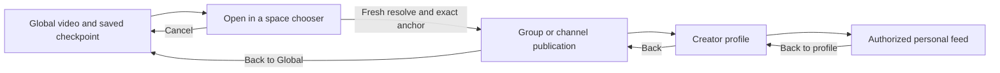

# Plan 173: Native creator action and Global-to-space launch with return

Status: Complete

Created: 2026-10-22

A–F Complete for the recorded internal signed build10 milestone with explicit limits. Functional, planned numerical and documentation gates pass. One recovered cold start on publication186 remains an open residual performance issue, not a claimed fix. Implementation is committed/pushed as `c8583f0`; remote implementation SHA verified, with delivery records following separately. This plan covers the first of two increments: Creator/Launch actions and the authorized Global → group/channel → Global journey. Native likes/comments follow in a separate plan.

## Feature Reference

- [Native viewing roadmap](../roadmaps/roadmap_native_viewing.md)
- [Personal-space and Global context integrity](../features/feature_02_personal-space-global-feed-context-integrity.md)
- Foundations: [Plan 169](plan_169.md), [Plan 170](plan_170.md), [Plan 171](plan_171.md), [Plan 172](plan_172.md)
- Existing viewer/session/text contracts: [API documentation](../../docs/API.md)

## Context

The user wants the remaining right-side Creator, Like and Comment actions and the Global Launch-to-space action, preserving Global's role as discovery. The agreed sequence is to deliver Creator/Launch navigation first, then engagement inside authorized spaces. Global must not show Like/Comment controls or engagement counts, including while signed in.

The accepted baseline is Video Viewer 0.1.0/build6, EAS `0f520676-1d89-4b8f-9f0a-b21a78fb59c0`, source `9e4731aebeb1c8aafdf99e313bcd1bca7a47292e708fbf978faa72726283ba65`. Plan172 implementation is pushed as `f0ed1b387166ccd42913e0168e388a6afa0d67e9`; delivery records as `721ecf3e34e3aedd5c7c5c3dd1c9fa0f4db3d05c`. Its confirmed Wi-Fi/CC-On sample has 42/42 normal transitions prepared, median 104.23 ms / p95 121.03 ms / max 124.76 ms, peak 3 and zero errors/incomplete/unexpected playback. Two initial/cold frames remain recorded, including 1469.71 ms. No frozen controls or audio overlap; brief CC loading flash resolved. Preserve the recorded accessibility/native-memory/upgrade-state limits.

In scope:

- Creator avatar/action in the right-side controls, reusing the accepted profile and authorized personal-space behavior.
- A Global-only Launch-to-space action and a native full-screen destination chooser.
- Additive viewer-authenticated discovery/resolve reads returning only currently accessible group/channel publications of the same production.
- Exact destination publication entry, contextual story/captions, original Global checkpoint restoration, and bounded composition with Creator/personal detours.
- Anonymous/sign-in, loading/empty/error, stale-result, denied/expired/offline and layout behavior; focused host/API/web/iPhone evidence and a signed internal preview.

Out of scope: native Like/Comment buttons, counts or writes; follow/report/membership/invitation/subscription changes; checkout; broader space directories; shared/external links; web viewer redesign; fixes to all legacy engagement endpoints; broader access-freshness optimization beyond the authorized bounded routine renewal below; native playback replacement; private-CDN delivery; OTA; TestFlight/App Store; full VoiceOver or native memory/battery qualification. No placeholder Like/Comment controls in this increment. No backend schema/migration, runtime/native dependency or monorepo changes expected.

## Inspection Findings

| Inspected owner | Finding and implication |
| --- | --- |
| `frontend/src/app/Feed.tsx` | `isGlobalBillboard` recognizes the aggregator and Global aliases. Its action rail renders Jump in place of Like/Comment/counts. Creator/profile behavior exists separately. Native must preserve the discovery/engagement distinction. |
| `frontend/src/app/JumpToSpaceModal.tsx` | Reads legacy `/api/publications/:id/jump-spaces`; opens group/channel URL with `?pin=<productionUlid>`. Multiple destinations and an empty result are supported, but exact destination publication and native return state are not represented. |
| `src/routes/publications.ts`, `src/features/publications/{service,repo}.ts` | Legacy Jump requires browser auth; it looks up the source publication directly and lists same-production group/channel rows with published/visible-in-space filters. It does not apply full source Global eligibility or destination viewer access/members-only eligibility. It excludes the source's space unconditionally. Do not expose this handler to native bearer credentials or copy its weaker filters. |
| `src/features/feeds/repo.ts` | Global selects `visible_in_global=1`, non-members visibility, published/timestamped publication and completed upload. A Global item can already be a group/channel publication; Global is a view, not necessarily a separate publication. Space selection separately checks `visible_in_space` and members visibility. Include the source's own group/channel if eligible. |
| `src/features/spaces/service.ts` | `canViewSpaceFeed` checks bans first, then site admin/owner/membership, public group/channel settings and active subscription. Personal requires explicit authority. New destinations must use these rules, not just `/me/spaces`, which omits public non-member destinations. |
| `src/db.ts` | Existing production/space unique key and feed indexes support publication mapping. Production IDs can be null on legacy rows. Do not guess a production from upload identity or require a migration for this milestone. |
| `src/routes/viewer.ts`, `src/features/feeds/{viewer,resume}.ts` | Viewer routes already support native/browser principals, no-store, exact publication anchors and bounded return windows. `aroundPublication` falls back to a normal feed when the anchor disappears: acceptable with notice for an original-feed return, but insufficient for initial Launch unless native rejects a missing target before playback. |
| `mobile/src/api/client.ts` | Bearer credentials are intentionally restricted to `/api/native/v1/` and `/api/viewer/v1/`; native cannot directly call legacy Jump. Reuse transport/timeouts/error handling; do not widen credential scope. |
| `mobile/src/navigation/{viewerJourney,ViewerNavigator,returnToFeed}.ts*` | One mounted Feed slot, release-before-context-swap, principal/generation guards, bounded Creator journey and `popTo('Feed')` avoid duplicate owners. Flat Creator origin currently cannot also serve as the Global Launch root. Keep separate bounded outer Launch and existing inner Creator state. |
| `mobile/src/feed/{useViewerFeed,adaptFeed,FeedScreen,FeedCard}.ts*` | Origin restoration is publication/context-specific; caches/text live inside each session. Creator ID/avatar are already minimized fields; the creator name already opens profile. Add the icon without replacing proven profile behavior. Fresh entry needs strict target validation distinct from tolerant origin restoration. |
| `mobile/src/ui/{IconButton,FeedHeader}.tsx`, rendered harness | Bundled icons, 44-point targets, protected caption/story lane, scalable header and real StackRouter integration already exist. Extend these; no new icon package or duplicate navigation host. |

These are source-inspection findings, not new endpoint/device test results. Existing Like services check published status and Comment services add comment/role checks; full shared space/publication/Global engagement enforcement must be addressed before native participation, outside this read-only milestone.

## Locked Decisions

1. **Context rules.** Global has Creator and Launch, plus existing playback/CC/Menu controls; no Like/Comment controls, counts or automatic engagement calls. In group/channel feeds, Creator and existing controls remain; native engagement is still deferred. Launch is absent in personal/group/channel contexts. Personal entry remains only through the accepted Creator authority path.
2. **Creator control.** Add a circular avatar action (approved public HTTPS avatar; bundled person fallback on null/load failure) in the right-side control rail. Label it `View <name>'s profile`, retain creator-name tapping, and hide/disable the icon when no valid creator ID exists. No follow badge/count. Taps must not toggle the underlying video pause.
3. **Launch is explicit.** Global action label `Open spaces for this video`; chooser title `Open in a space`, rows show name/type and a clear Open action. Always show the chooser, even with one result; no automatic transition. Empty is normal: `No accessible spaces for this video`. Do not claim a specific hidden space exists or expose inaccessible names/counts. A source without a mapped production gets an empty result, not an upload-based guess. If a response establishes that the Global source is no longer eligible, cancel/Back must refetch an authorized Global window and show the existing unavailable-origin notice; never simply resume that known-unavailable mounted source.
4. **Authentication.** Listing/resolving destinations requires sign-in, matching existing browser Jump and native space-feed policy. Anonymous Global can open the chooser's sign-in explanation and CTA without fetching protected destinations. Successful sign-in follows existing identity reset to Global; the user deliberately taps Launch again. No stale chooser/entry/checkpoint survives sign-in/account switch/session expiry. Cancellation returns to the same anonymous video. This increment does not introduce cross-account deferred navigation or anonymous space playback.
5. **Destination scope.** Offer currently viewable published group/channel videos, including public non-member spaces allowed by existing authority. Exclude personal spaces and all reserved Global representations/aliases. Include the source space if it is a genuine eligible group/channel. Do not create memberships/subscriptions or show locked private-space teasers. Broader discovery/join flows remain later work.
6. **Two exact identities.** Server maps source Global publication → same internal production → destination publication in selected space. The client never assumes Global publication ID equals or differs from destination ID, nor reuses Global ID for destination text/engagement. The source's production ID is server-owned; clients supply source publication and chosen space only. Production ULID is optional corroboration, not authority; media URLs/upload IDs are not identity keys. Store/adapter compares any captured known source ULID with all list pages and the fresh resolve, rejecting a changed production instead of carrying an old intent into it.
7. **Entry continuity.** Capture Global publication/time/manual pause once at Launch opening. On successful target resolution, enter that exact space publication near the captured playback position when the captured/resolved production ULIDs agree, preserving intentional pause and clamping against loaded production duration. For legacy null/unknown source ULID, server mapping still authorizes the exact destination but start at 0 rather than applying an unverified time offset; retain manual pause. A changed known production invalidates the entry. Latest session sound/saved CC follow the user. Do not render/play an arbitrary first item if the target disappears. If target/production identity cannot be established, show recoverable unavailable state and keep Back to Global.
8. **Return.** Destination header provides `Back to Global`. Refetch Global around the saved source publication and restore time/pause through existing coordinator behavior. If it was unpublished/removed, retain the existing original-video-unavailable notice and authorized fallback semantics; never treat another video as restored or apply the old time to it. The outer checkpoint also records the known source production ULID; if a refetched source has changed production, treat saved position as unavailable and never seek the replacement to the old time. This is separate from strict initial Launch. Checkpoints are in-memory and contain no pages, media URLs, players or credentials. Relaunch starts Global as today.
9. **Bounded composition.** One outer `GlobalLaunchJourney` retains Global root/source and launch identity; existing `ViewerJourney` handles an inner Creator → personal detour anchored to the launched space. No recursive/unbounded stack. Inner Back-to-profile takes precedence; after returning from profile, Back to Global is available again. Repeated Creator visits replace the inner target while retaining its local origin. Explicitly selecting a different space clears both; selecting the current space preserves both. Reset both on principal/API-origin generation changes.
10. **Refresh and coverage.** Destination Menu Refresh resets that destination feed from the beginning and clears its one-shot target anchor, while preserving the outer Global checkpoint. It must not snap back to the launched target on every Refresh. Chooser/profile/Menu/Account/Settings cover and pause Feed through existing eligibility; no hidden audio/captions/story. Account/Settings return to their caller; existing access revalidation remains intact. Back to Global discards inner state.
11. **Authority and failures.** Resolve verifies source eligibility and selected destination again; feed load rechecks space/publication access afterward. Permission loss while playing uses existing guard; 403 leaves account signed in, 401 clears identity/journeys. Abort/stale results cannot switch context, resurrect an account, emit old names or resume audio. Offline Retry is recoverable, with no bypass of validation.
12. **Source/distribution.** Preserve three-player budget and release all prior leases before replacing active Feed. No generic nested Feed navigator. Use existing signed internal build profile; choose the next available iOS build number at execution (expected7 after6), stamp actual source, verify archive/artifact/provisioning, install over the app. Do not assume restarting Metro changes this embedded app. No commit/push during planning or implementation unless requested.

## Proposed API Contract

Add read-only routes under the existing viewer router; do not alter or silently migrate legacy browser Jump in this milestone.

| Route | Purpose |
| --- | --- |
| `GET /api/viewer/v1/feed/global/publications/:publicationId/spaces?limit=20&cursor=...` | Fresh source eligibility, paginated authorized destinations for the source production. |
| `GET /api/viewer/v1/feed/global/publications/:publicationId/spaces/:spaceId` | Resolve a chosen space again immediately before entry; returns its exact eligible publication. No client-supplied target publication/production is trusted. |

Both require `resolveViewer(req,true)`, support native bearer **or** browser cookie, reject ambiguous/invalid auth, and inherit `Cache-Control: no-store`. GETs have no membership, counters, playback or credential side effects. Avoid fetching targets in normal feed preloading; load only on explicit Launch.

List DTO:

```json
{
  "sourcePublicationId": 100,
  "productionUlid": "01ARZ3NDEKTSV4RRFFQ69G5FAV",
  "items": [
    {"space": {"id": 12, "name": "Example group", "type": "group"}, "publicationId": 205}
  ],
  "nextCursor": null
}
```

Resolve DTO:

```json
{
  "sourcePublicationId": 100,
  "productionUlid": "01ARZ3NDEKTSV4RRFFQ69G5FAV",
  "space": {"id": 12, "name": "Example group", "type": "group"},
  "publicationId": 205
}
```

`productionUlid` is a bounded valid ULID string or null; the examples use a dummy valid ULID. IDs are positive safe integers. Space type is exactly group/channel; name bounded to 200 characters. Exclude settings, hidden destinations/total counts, email, owners' private data, storage keys, source URLs and engagement fields. DTO parsers construct an allowlist rather than retaining unknown fields.

Selection algorithm:

1. Validate IDs/query; confirm source by the exact existing Global row selector with `publicationId` and current viewer. Missing/ineligible source →404 `publication_not_found`. Reuse shared eligibility predicates, including visibility/status/upload readiness; do not authorize source through a direct publication lookup alone.
2. Resolve source production internally. Missing production mapping →empty list; selected-space resolve →404 `launch_target_unavailable`. Do not infer from upload or permissive web `pin` helpers.
3. Find same-production publications in non-Global group/channel spaces. Existing `(production_id,space_id)` uniqueness supports one row/space. Check current bans/space access and exact space-feed publication eligibility. Empty/hidden/members-only/pending/unpublished rows cannot become launch candidates just because another publication is public. Use the same authority for list and resolve; no separate permissive lookup.
4. Paginate by stable ascending space ID; default 20/max 50 with strict limit/cursor validation. Cursor is bounded opaque version/source/viewer/last-returned-authorized-space state; it contains no hidden candidate identity or credentials and grants no authority. Reject a cursor scoped to another source/principal. Recheck permissions on every page. Candidate filtering must precede returned-page limits or continue scanning past filtered candidates until enough authorized rows/exhaustion; never return a false empty/end-of-list because the first batch is hidden. Bound candidate batches/concurrency, honor cancellation/timeout, and fail safely with 503 rather than silently truncate. Phase A records query counts/EXPLAIN and exercises hidden candidates before allowed candidates. No unbounded `Promise.all` across all spaces.
5. Recheck source and final chosen eligibility before sending a resolved entry; database/helper errors are 503, not an empty list or assumed grant. Later anchored feed access remains authoritative if permission changes after resolve. List is a discovery snapshot, not a durable capability.

Errors:400 `invalid_query` (IDs/limits/cursor);401 `unauthorized`;404 `publication_not_found` for unavailable Global source;404 `launch_target_unavailable` for absent/inaccessible/non-group/channel/unmapped selected target (generic, no private name);503 `service_unavailable`. Existing actual space-feed403 still means access unavailable without logout. Extend native safe-error mapping for the new target code only. Error bodies contain just the public error code.

After resolve, use existing `/spaces/:id/feed?anchorPublicationId=<resolvedPublicationId>&limit=60`, with a **strict entry intent** in the native loader. Validate context, requested/restored anchor, item presence, target publication/space and any known production ULID before activating a coordinator. An `unavailable` anchor must produce a target-unavailable screen, never select the fallback video's index0. Preserve existing tolerant anchor behavior for original-feed returns. The target anchor is consumed once; pagination remains ordinary opaque feed pagination. A retry re-resolves the selected target before trying again.

## Navigation and State Design



- Add `GlobalLaunchJourney` as a small typed owner keyed by API origin/auth generation/launch generation. States distinguish chooser, resolving, active destination and returning/error; asynchronous results also carry source publication and live Feed key. Repeated taps create at most one active chooser/resolve.
- Keep Global's Feed mounted while chooser is open; capture pauses selected playback, focus coverage removes text/audio. Ordinary cancel dismisses directly with no refresh/replacement and clears provisional launch state. Exception: known source-unavailable responses invalidate its playback/text and force fresh authorized Global restoration/fallback; they never expire an otherwise valid account. Commit outer journey only on accepted resolution/transition; after failed entry Back/Cancel can still restore Global.
- New route `LaunchSpaces` carries source identity/generation only, never a full DTO/player/token or callback. Store owns validated pages, aborts and pending selection. Current-principal/focused-route/Feed-key/generation checks guard every callback, including late image requests and native back gestures.
- Context replacement uses the existing single Feed route and release-before-transition. Add a separate strict entry intent (`publicationId`, expected context/production, captured time/pause and known source production ULID) rather than pretending destination is the original `FeedCheckpoint`. Surface failed entry separately from space denial and original-source disappearance.
- The outer root and inner Creator checkpoint are separate, bounded records. While Creator/profile/personal is active, existing Back semantics restore the launch-space video first; outer root remains untouched. Opening Creator from ordinary Global/personal continues existing Plan169 behavior without an outer launch root.
- Derive header Back from current journey/context: inner personal → Back to profile; launched group/channel with no active inner detour → Back to Global. Menu → utilities → caller, Menu Refresh, same/different selector choices and native profile/chooser back must not destroy or duplicate these owners. Transient callbacks from removed routes are ignored.
- Source/target text and diagnostics retain exact context/publication/auth generation. Global and destination may legally use the **same publication ID in different contexts**; cache keys and error handling must still separate them. No copied story/cue/count state across entry.

## UI and Failure Matrix

| Situation | Required behavior |
| --- | --- |
| Creator icon/name, anonymous or signed in | Same approved profile; hidden profile fields remain omitted; approved avatar/fallback; no implicit personal access. |
| Global Launch, anonymous | Sign-in explanation/CTA or Close; no destination fetch/names. Sign-in resets to Global, deliberate new tap required. |
| List loading, retry or pagination | Scrollable native screen, bounded loading feedback, Retry/Load more when relevant; old results clear on source/account changes; Cancel remains reachable. |
| No mapped production/no accessible destinations | Neutral empty message, no claim about private or unpublished spaces, Close returns same video/pause. |
| One/many destinations | Same explicit chooser; names/type wrap; deliberate row selection re-resolves access and publication. |
| Source removed while chooser open | Recoverable source-unavailable message, clear destination results and invalidate old source playback/text; Cancel/Back refetches Global with explicit missing-origin fallback rather than resuming a known-ineligible cached item. |
| Target disappears or changes after selection | No unrelated autoplay; target-unavailable with Retry, Choose another space and Back to Global. Current account retained unless401. |
| Target space access revoked | Stop media/text; access-unavailable recovery; Account still signed in; Back to Global works. |
| Session expires/sign-out/account switch | Existing anonymous Global reset; clear both journeys, chooser pages/intents and protected text/media. Back cannot reopen protected context. |
| Offline chooser/resolve/return | Recoverable connection/access error; no offline grant. Restored connectivity retries in same account unless session invalid. |
| Small viewport/large text | Right rail has44-point targets and stays outside captions/story/retry lanes; chooser/header controls remain reachable. Allow bounded rail scrolling if all actions cannot fit, without shrinking targets or intercepting feed swipes. |
| Background/lock/covered utility | Hidden audio/text stop; same eligible video/pause returns after existing validation. Do not change Checking Access behavior. |

Use existing native dark screens/safe areas and bundled owned artwork; web object-properties modal CSS does not apply to this native chooser. Place Creator/Launch in the existing right control lane while keeping accepted CC/audio appearance and preference behavior. No new decorative library; meaningful accessibility labels and non-color state cues, without claiming full VoiceOver qualification.

## Phase Status

- A: Complete — authorized destination list/resolve contracts and backend tests
- B: Complete — typed native destination store and bounded journey/entry state
- C: Complete — Creator/Launch controls, chooser and single-Feed navigation
- D: Complete — integrated host/API/browser fixtures and regression gates
- E: Complete — signed build10 and focused iPhone acceptance with recorded limits
- F: Complete — source-matched playback gate, residual review, cleanup and handoff

At most one execution phase may be In Progress. Do not advance a phase on source inspection alone.

## Phase A — Authorized Destination Contracts

Goal: expose exact safe destinations without changing browser/global playback or engagement behavior.

- [x] Add focused viewer-launch service/repository helpers and two viewer routes above; reuse source/space publication selectors and existing authority. Exclude Global aliases, include genuine source group/channel, handle legacy null production and same-ID/different-context cases.
- [x] Implement minimized DTOs, query/cursor validation, bounded/cancellable candidate work, generic target error and fail-closed service failures. Revalidate chosen target; preserve existing bearer/browser ambiguity semantics and no-store.
- [x] Add injectable service/query boundary tests covering source eligibility, production-to-publication mapping, public non-member, member/subscriber/owner/admin, bans, personal/Global exclusions, members-only filtering, null source production, hidden-first pagination, cross-source/principal cursors and database failures. Verify no writes/counters or private fields.
- [x] Inspect query plan/index use and record bounded work/query counts for wide fixture scenarios. Prefer shared predicate extraction if needed; no new schema by default. Do not change legacy endpoint response or open its native credential scope.
- [x] Document API contracts in `docs/API.md` once implemented.

Test gate: `npm run build`; `npm run test:viewer` including proposed `tests/backend/nativeLaunch.test.ts`; no regressions in session, creator, text and anchor tests. Unit mocks are not real DB/access proof; reserve that for D.

Acceptance: safe same-production destinations and exact target resolve, with source and destination authority independent; unauthorized metadata/errors minimized, pagination complete or explicitly failed.

## Phase B — Native Store and Journey State

Goal: make stale/cancelled/identity transitions and strict entry explicit before wiring UI.

- [x] Add typed launch API adapters and cancellable store, paging/selection busy states, forced re-resolve before entry, safe new error mapping, no persistent cross-principal cache.
- [x] Add outer GlobalLaunchJourney and typed strict entry intent, retaining existing inner ViewerJourney. Bound memory to root/source and local creator checkpoint; no arrays of historic feeds/players.
- [x] Extend loader/adapter/session activation so a missing/mismatched launch target fails before playback; existing return fallback remains unchanged. Consume entry anchor once, clear it on destination Refresh; retry resolves current mapping again.
- [x] Test invalid DTO IDs/types/production/context, null production-ULID start-at 0, changed-production time rejection, stale source/identity, aborted retries, concurrent taps/page loads, failed entry, known-source-unavailable cancel/return, seek clamp/pause, refresh and current/different selector state. Explicitly test nested Creator/personal returns, repeated creator replacement and authentication generation reset.

Test gate: `npm --prefix mobile run typecheck`; `npm --prefix mobile test`, adding focused launch/store/journey/strict-entry cases. Assert no bearer to legacy routes and no stale entry into a new principal.

Acceptance: one outer/one inner bounded journey with exact entry versus tolerant origin return; existing profile, auth and feed tests remain green.

## Phase C — Native Actions, Chooser and Return

Goal: deliver the full user flow through the existing navigator/player.

- [x] Add bundled Launch artwork and Creator avatar/fallback action; reuse creator-name route; restrict Launch to Global and omit Like/Comment/counts everywhere until the later participation milestone.
- [x] Add full-screen LaunchSpaces with sign-in/loading/empty/error/list/load-more/open/cancel; preserve current focus coverage. Add Back to Global and distinguish target-unavailable from access unavailable and old-source fallback.
- [x] Integrate outer/inner journey state with single Feed slot, `returnToFeed`, current identity/Feed key and focus checks. Release leases before changing context; never temporarily focus old Feed during intermediate route replacement.
- [x] Preserve same-space selection, explicit different-space reset, Menu Refresh/current caller, Account/Settings returns, CC/sound/story behavior and interrupted/late callbacks. Include Global source space when authorized.
- [x] Verify rail/chooser/header on320/375-point widths, normal/large/maximum font-scale inputs and short remaining viewport; no overlapping targets/text or tap-through. Approved avatars/fallbacks only; image load failures cannot trigger navigation.
- [x] Extend actual-component/real-StackRouter harness for Creator icon/name, chooser cancel, anonymous gate, fresh resolve, exact target, Back Global, nested personal path, menu/selector/refresh/expiry and <=3 shared player cleanup. Cover both internal-preview and ordinary Release diagnostics policy.

Test gate: mobile typecheck/unit tests and `npm --prefix mobile run test:ui`. Assert one Feed route, selected-only audio, no stale caption/story, source pause/time preserved, target pause/time restored only after identity checks; native geometry remains a phone gate.

Acceptance: usable discovery-to-space journey with existing viewer behavior retained; no fabricated social controls or implicit grants.

## Phase D — Integrated Contracts and Regression Evidence

Goal: establish real database/auth behavior and browser compatibility before signed device work.

- [x] Add opt-in `scripts/native-launch-fixtures.ts` and `scripts/check-native-launch.ts` with package commands (proposed `viewer:fixtures:launch`, `viewer:check:launch`). Seed new labeled fixture accounts/spaces and destination publication metadata referencing a pre-existing eligible public Global production; **do not create/change Global publications or normal-account grants**. Keep credentials in ignored mode0600 storage; no secret stdout. Record source-publication volatility explicitly.
- [x] Include eligible group/channel, public non-member, members-only restrictions, subscriber/owner, banned, private-without-authority, personal, invisible/unpublished and missing-target cases. Test real viewer API native/browser parity, ambiguity/expiry/503, exact source/target story, same-production differing publication IDs, current source-space inclusion when feasible, and stale mapping. Read-only legacy browser Jump regression; no production participation writes.
- [x] For source rows that cannot safely be made volatile/Global-hidden, use injectable host contracts for that mutation; never unpublish an ordinary source solely for testing. Fixtures must not assume old Plan169/170 user/space/session IDs or reuse old device-access drivers.
- [x] Run state-mutating API scripts sequentially with try/finally restoration of only their own rows/grants and revocation of only host-created sessions. Device helper must bind exact new test account/space/current session after confirmation; leave ordinary accounts untouched.
- [x] Add focused browser smoke for existing Global Jump versus group/channel Like/Comment presentation and existing Creator navigation. New viewer API browser tests do not silently migrate web Jump. Run changed backend/mobile suites and the existing creator/text API regressions sequentially; reuse unrelated earlier evidence with stated limits.
- [x] Production Hermes export, source-stamp verification and actual EAS archive inspection; mobile-only inputs, locally bundled artwork, no credentials/fixture/evidence inclusion. Root README only for implemented API/script/workflow changes; mobile README for actions/returns.

Test gate: `npm run build`, `npm run test:viewer`, mobile typecheck/unit/rendered checks; proposed launch fixture/API/browser checks; existing viewer/creator/text contract regressions where touched; `npm run web:build:scoped` and focused browser UI smoke if frontend/shared browser behavior changes. Document commands actually executed and distinguish controlled versus live transport/device evidence.

Acceptance: exact native/browser viewer contracts pass; existing web viewer remains functional and private metadata/grants are preserved. No signing until source/host gates pass.

## Phase E — Signed Preview and Focused iPhone Acceptance

### Protected routine-check behavior — quiet bounded renewal authorized

The launched-space10/50-second video covers are reproduced. Existing [Plan168 decision12](plan_168.md) blocked protected viewing whenever validation was pending. After discussing signed URLs and access checks, the user explicitly requested silent routine checks and stopping video on failed checks. This amendment supersedes that pending-check rule for already-verified, uninterrupted viewing only; initial entry, covered/foreground return and failures remain blocking.

Selected implementation amendment:

- Initial entry, a different identity/context, foreground/unlock/covered return, explicit Refresh and recovery Retry still require fresh verification before showing protected media/text.
- During uninterrupted eligible viewing, renew already-verified access before expiry (target45 seconds) while keeping content visible only within a hard60-second window from its last successful verification. A pending request does not extend that deadline. At denial, network failure, stale/expired verification, pause/hide immediately; abort/ignore late results.
- Coordinate account and space checks to remove the two presentation clocks. Keep separate exact-publication text authority, renewing captions/expanded stories early with their own verified timestamps and hard expiry. Cache hits never extend verification age. Do not simply turn off polling, suppress failures or keep protected content indefinitely while waiting.
- Add actual timer/real-hook tests with different app/space ages: quiet healthy renewal, deadline expiry while response hangs,401/403, offline error and Retry, background/focus reset, stale responses and identity switch, caption/story cache age. Reuse current source/publication guards and one-player ownership. Then typecheck/unit/rendered gates, new source/export/archive/artifact checks and signed build; focused phone renewal/denial/lifecycle acceptance before final playback sample.

Implementation: a shared VerifiedRefresh controller renews at45 seconds and expires at60 seconds from request start for protected media/text. The active space guard owns combined account/space renewal; AuthProvider retains its fallback cadence on Global/non-feed screens and always validates foreground returns. Protected caption/story cache samples retain their original verification timestamp. Explicit Refresh blocks, failures clear, expiry aborts and ignores late completions. Global retains its accepted quiet periodic presentation.

Follow-up from device evidence: public Global must remain visually steady while an already-signed-in account validation is pending. The expiry/error response and blocking protected entry/return checks stay in place; routine checks now follow the authorized amendment above. This narrow presentation correction is in scope for the reported defect; broader access freshness optimization remains deferred. The subsequent caption-only report also requires public Global cues to remain visible during their independent periodic fetch, with protected/error/hidden clearing retained.

Goal: accept new navigation/icons in a bundled source-matched app, with minimal repeated phone work.

- [x] Select next unused iOS build number, `npm --prefix mobile run prepare:preview`, `export:preview`, inspect archive and `build:preview -- --non-interactive` through existing runbook. Use valid app/device signing; no new Metro dependency, OTA or store submission. Verify artifact source/API/version/app ID/provisioning before offering install.
- [x] Installed over the existing app through previews7–10. Build7 basic Global/Creator/Launch checks and build10 CC/speech/media checks pass over the recorded protocols; signed artifact source verified. Existing build6 supplies unchanged preference/control evidence only. Pre/post upgrade settings comparison is unverified; new avatar/fallback and maximum rail geometry have host coverage. Final diagnostic sample will independently confirm exact build/source.
- [x] Build10 focused quiet-renewal phone check: signed-in Global/CC On paused with a visible caption → Launch test group;75 seconds visible paused then about30 seconds playing. User confirms no flashes and all good. Picture/caption stability, caption speech sync and no unexpected audio interruption pass over this prompted scope.
- [x] Build10 launched-group background/return, lock/unlock and manual pause through Menu → Account → Done pass per prompted phone protocol. User then left sound/CC playback running for the scoped denial check.
- [x] Build10 access denial: only disposable A28’s space_member grant in work-created private Launch test group66 removed. Phone automatically shows Access unavailable with video/audio stopped and protected story/captions hidden; no Refresh needed. Account remains signed in. Exact saved role restored immediately after the observation and server authority confirms canViewSpaceFeed=true. No outstanding grant mutation; no session/publication changes. Evidence: `tests/runs/device/plan_173/access-remove.json`, `access-restore.json`, `acceptance.json`.
- [x] Build10 recovery after restored group permission passes: video/audio/captions and exact “Destination story for launch group” return without a password; Back Global restores original near saved position, still paused, no overlapping audio. User says all good; Retry versus Refresh was not separately specified.
- [x] Remaining playing/Refresh/offline/identity protocols pass on build10: playing Global → exact group near position → destination Refresh → playing Global near saved position without overlap; offline chooser/Close stays responsive and recoverable, reconnect reopens chooser without password; sign-out from protected group resets to anonymous Global with no protected Back, Account/Spaces sign-in and anonymous chooser Sign-in/Close only. User confirms all tests good.

Coverage limits: build7 paused exact/nested journeys and build6 unchanged preferences/menu/header checks are carried only for unchanged behavior. New same/different-space journey reset, rare empty/missing/hidden destinations and maximum four-action rail geometry remain host/API evidence; no new physical maximum-font/VoiceOver/native memory or upgrade-comparison claim. Phone offline error wording and Retry-versus-Refresh are not separately reported. These limits do not leave a required repeat protocol pending for this internal milestone.

| Protocol | Required observation |
| --- | --- |
| Anonymous Creator/Launch and cancel | Creator opens approved profile; Launch offers sign-in without destination names; cancel preserves original video/pause. Sign-in resets to Global and a fresh Launch works. |
| Signed-in Global → chooser → group/channel → Global | Select a recognizable video5–10sec in, pause it, Launch and choose the test destination. Same production/destination-specific story appears near saved time, still paused; Back restores original Global video/time/pause. Repeat playing with sound; no overlap. |
| Nested Creator/personal detour | From launched space open Creator → personal; Back to profile → Back restores launch-space video/pause, then Back to Global restores root. Menu Account/Settings preserve caller; same-space selector preserves return; different-space selection deliberately clears launch journey. |
| Destination Refresh/cancel/empty | Refresh changes only active space feed, retains Global root, does not re-anchor every time; chooser cancel/neutral empty recover cleanly. Use host evidence for rare unmapped/hidden cases not naturally available. |
| Lifecycle and denial/recovery | One background/lock cycle stops hidden sound/text. If needed, remove only a confirmed fixture's launch-space grant: access unavailable stops media/text but retains sign-in; restore and Retry recovers; Back to Global remains available. No repeat of unrelated personal-grant tests. |
| Offline/identity | Offline chooser/resolve and Back show recoverable error/no protected playback; reconnect recovers without password when session valid. Confirm fixture session expiry or explicit sign-out clears both journeys and protected Back; existing B-isolation host checks cover stale completions. |
| Layout/persistence | Right targets/chooser/back and long names reachable over recorded text sizes; fresh saved CC/start sound/account survive close/reopen if source touched. Restore usual size before timing. No full VoiceOver claim. |

Acceptance: new source installed, focused flow/authority/pause/layout checks pass over recorded scope, existing build6 functional evidence reused only for unchanged paths. New read-only access fixtures restored before final sample; no timed stress run unless a demonstrated regression needs one.

## Phase F — Playback Gate, Cleanup and Handoff

Goal: close a comparable internal milestone without hiding cold/initial/interrupted behavior.

- [x] Source-matched build10 signed-out Global sample:54 selections, stable Wi-Fi/usual text size/CC On and Refresh/forward direction confirmed. Full export received after the compact sample. Several clips advanced before two media seconds;34 prepared rows have retained>=2s progress and independently meet>=30/p95<=150ms (p95133.48ms). No claim of uniform dwell; all rows retained, no repeat requested.
- [x] Original planned gates pass:52 prepared normal frames,p95132.86ms/max135.19ms,52/53 normal prepared (98.11%),peak3,0 recorded errors/incomplete/unexpected playback. All54 have playing/progress evidence. Full carried1+59 allocations−59 releases=live1; original compact55/55 also balances. Cold186 firstFrame7955.21ms,playing8269.70ms,progress8648.80ms and initial620.84ms remain included. Final row interrupted after playback by sharing/coverage; later background/reallocation is post-sample and adds no selection. No additional freeze/overlap/caption defect reported; do not infer no in-place buffering from first-frame metrics.
- [x] Build6 prepared p95121.03ms/42-of-42 remains comparison: build10 p95132.86ms is11.84ms higher, within the unchanged150ms target; normal preparation98.11% versus100%. No causal claim from one sample. Full timeline confirms cold186 is unbuffered, recovers, then is prepared on repeat (firstFrame123.39ms,playing70.19ms). Its root cause remains unconfirmed and is tracked explicitly below; no new cold-maximum threshold invented or existing row excluded.
- [x] Exact A28/group66 membership and destination visibility restored; temporary subscription absent. After the user’s explicit device sign-out, read-only fixture-only audit confirms0 active native sessions for A/B,0 fixture Global publications and0 temporary subscription rows. No broad logout, publication mutation or extra revocation. Work-created fixture metadata retained. Evidence: `tests/runs/device/plan_173/cleanup-after-device.json`.
- [x] Plan/index/roadmap/API/mobile/root documentation and exact build/install/source/host-versus-device limits recorded. Source identity unchanged; final whitespace/link/private-input and agent-docs baseline checks pass (same16 prior older-plan findings,0 new). Implementation is committed/pushed as `c8583f0`; remote implementation SHA verified, with delivery records following separately.

Acceptance: A–F Complete with evidence and limits; native Creator/Launch/return available in independent internal app. Next plan can implement likes/comments in spaces with separately enforced server context rules and native authenticated writes.

## Expected File Impact

| Area | Likely files |
| --- | --- |
| Backend routes/service | `src/routes/viewer.ts`; proposed `src/features/publications/viewerLaunch.ts` plus focused repo helper; shared feed/space eligibility helper only if needed without contract drift |
| API tests/docs | proposed `tests/backend/nativeLaunch.test.ts`; `docs/API.md`; proposed launch fixtures/check scripts and package commands; focused web regression script |
| Native contracts/store | proposed `mobile/src/spaces/launchApi.ts`, `launchStore.ts`; existing safe error map and feed loader/adapter for strict entry |
| Navigation | proposed `mobile/src/navigation/globalLaunchJourney.ts`; `ViewerNavigator.tsx`, existing creator journey/header only for explicit composition |
| Controls/screens | proposed `mobile/src/spaces/LaunchSpacesScreen.tsx`, Creator/action rail component; `FeedScreen.tsx`, `FeedCard.tsx`, `FeedHeader.tsx`, `IconButton.tsx`, owned icon assets |
| Native tests | launch store/journey/entry unit cases and actual rendered router/feed/icon/chooser coverage |
| Build/continuity | deliberate mobile app build number/source stamp, mobile/root README where needed, plan/index/roadmap; no native plugin or schema change expected |

Names are proposed; keep ownership narrow and prefer existing helpers. No dormant Like/Comment API migration is included merely to reserve future file names.

## Change Log

- 2026-10-23 implementation delivered: `c8583f09c19dde6377140be9358189a7bbfe72aa` pushed to `origin/main`; remote SHA independently verified. User explicitly authorized commit/push. Delivery records follow in a separate documentation commit; signed build10 product identity is unchanged. Private fixtures, local evidence and signing inputs are excluded.

- 2026-10-23 delivery authorized: user explicitly requested commit and push after milestone completion; reviewing the existing accepted scope and verifying remote delivery. No product source or phone protocol changes.

- Internal milestone complete on signed build10/source `1a84eb7db9bef26232fdcefa2c5189e0ea3c4ecdb8a2e3ebd7b72e9f24679bae`: A–F Complete with recorded functional/physical/history limits. Performance gate passes after full timeline review; recovered cold186 stall remains explicit residual. Fixtures restored, no active native fixture sessions, source unchanged. No further phone protocol or product edit; commit/push not requested.

- Protected renewal follow-up authorized and implemented: quiet early account/space and publication-text checks, hard60-second verification age, strict entry/return/Refresh/failure handling. Host/source/archive gates pass; signed build10 artifact verified; focused paused/playing renewal passes on phone, with lifecycle/manual-pause checks pass; scoped grant-denial/recovery pending. No commit/push requested.

- Caption follow-up — build8 video improvement confirmed on phone, caption refresh flicker still present. Build9 retains public cues during periodic fetch; protected/error clearing and cadence unchanged. Actual timer/account-combination tests,152 units/18 rendered/typecheck/export/archive pass; signed artifact and phone result pending. No commit/push requested.

- Device follow-up — build8 fixes timed public Global account-validation coverage. Timers/authority/backend unchanged;152 unit/16 rendered, typecheck/export/archive/artifact gates pass. Phone minute-boundary result pending. No commit/push requested.

- Implementation — A–D complete: minimized destination reads, Creator/Launch native UI and bounded return state, strict entry, fixture/API/browser regressions and source-matched export/archive. E signed preview/device acceptance In Progress; F Pending. No commit/push requested.

- Uncommitted planning — researched accepted source/web/native/access/schema/test owners, authored Plan173 and linked next milestone. No product/API/schema/build/fixture/signing changes.
- Baseline implementation: `f0ed1b387166ccd42913e0168e388a6afa0d67e9`; delivery: `721ecf3e34e3aedd5c7c5c3dd1c9fa0f4db3d05c`.

## Validation

- Final build10 full-report review (`2026-10-23T19:56:34.331Z`): all54 timing/flag rows extracted and statistics independently recomputed to match compact summary. All54 report playing/progress,0 errors/incomplete/unexpected. Stable Wi-Fi/usual text/CC and Refresh/forward direction confirmed. Cold186 started loading2465.32ms before selection; replacement completed1950.82ms before selection;0 buffer, firstFrame7955.21ms,ready8262.19ms,playing8269.70ms,progress8648.80ms. No recorded coverage/lifecycle/context/restore/error event during that selection. It plays through6.5 media seconds and is prepared with6s buffered on the next pass: load-to-ready527.02ms,playing70.19ms,firstFrame123.39ms,progress459.73ms. Root cause cannot distinguish CDN/Wi-Fi/AVPlayer versus JS scheduling; retain open residual, not a fix claim. Full also retains a short238 playing-false/ready/true sequence (~511ms), cause uninstrumented. Final interrupted row has playback evidence before Menu; later lifecycle/reallocation after the compact sample does not change54 selections. Full resources1+59−59=1,peak3;51 older events dropped,0 transitions dropped.34 prepared rows with>=2s retained media progress pass p95133.48ms; some faster rows retained, no uniform pacing claim. Original planned thresholds pass with limits. E/F Complete; no further phone run or speculative code change. Evidence: `tests/runs/device/plan_173/playback/build10-full-report-extract.json` (extract, not complete raw event array; full export in conversation), `build10-assessment.json`, `build10-cold-start-residual.json`.

- Build10 final compact sample received (`2026-10-23T19:39:32.654Z`), exact signed source matches.54 transitions/frames,53 normal,52 prepared; normal preparation98.11%, prepared p95132.86ms/max135.19ms, normal p95133.48ms/max7955.21ms; initial620.84ms. Peak3, carried1+55 allocations−55 releases=live1;0 errors/incomplete/unexpected playback/issues,0 dropped transitions,23 older events dropped. Numerical gates pass, but full acceptance remains pending actual full-report timeline review of the recovered cold outlier: Global186, session22/activation20,0 buffer, preload2465.32ms before selection; replace resolves514.50ms after load (1950.82ms before selection); first frame7955.21ms, native ready8262.19ms and first progress8648.80ms after selection, playingObserved=true, no error/interruption. User estimates2–3s pause/spinner around videos15–20, expanded run to about50 without recurrence; do not replace recorded latency with estimate. Prepared p95 is11.84ms above build6 baseline, still within150ms; no causal attribution from one sample. Full retained report requested to examine playing/status/progress; User subsequently confirms stable Wi-Fi/usual text size/CC On and Refresh followed by forward traversal. Original observation says all smooth except isolated stall; no extra symptom claim inferred. Follow-up export is the same compact timestamp/marker, not a full transitions/events export. Actual Share full report versus Share report handlers verified through controlled native Alert/Share ports; fresh full export requested only, with no reset/reload/new run. No new run, product edit or signing. Evidence: `tests/runs/device/plan_173/playback/build10-compact.json`, `build10-assessment.json`.

- Build10 functional acceptance Complete over recorded scope: user confirms playing exact Launch/destination Refresh/playing Global return, offline chooser/Close/reconnect without password and protected sign-out/anonymous chooser gates. Earlier build10 quiet renewal, lifecycle/manual pause and automatic denial/restored exact-text/paused return pass. Read-only cleanup audit confirms exact restored group membership/visibility, no temporary subscription/Global fixture publication and0 active native sessions for both disposable accounts. Source unchanged from verified signed10. E Complete; F In Progress awaiting the final isolated Wi-Fi/CC-On/usual-size/anonymous forward sample. No further functional phone repeat requested; host-only/physical/upgrade limits explicit above.

- Authorized routine-renewal follow-up: reproduced old app/space timer offsets are now tested with the actual AuthStore, useSpaceAccess, AccessGuard, FeedScreen, text resources and coordinator using controlled timers/native/HTTP ports. Healthy paused/playing renewals preserve player, position and captions across former10/50 boundaries; tests cover hanging renewals/hard expiry, late completion,401/503, Retry, covered/background return and context/sign-out invalidation. Dedicated caption/story cases check original cache age, quiet renewal, hard expiry, error/denial and Retry. Typecheck,161 unit and27 rendered tests pass. Production Hermes export and actual EAS archive match99 source inputs/100 files (507488 bytes), Hermes2099045 bytes, with source/API embedded and no private inputs. Source `1a84eb7db9bef26232fdcefa2c5189e0ea3c4ecdb8a2e3ebd7b72e9f24679bae`; build10 `a8c46663-bdb5-42c0-83a0-bef42e486818` submitted. EAS finished2026-10-23T18:31:53Z. Downloaded signed artifact passes expected0.1.0/build10/app ID/source/API/registered-phone checks, get-task-allow=false and OTA disabled; IPA8245310 bytes, SHA256 `8d242e3fb189ceeb964df14582a7cabc15c516234ff513696e4635274dc105c9`, embedded bundle2099135 bytes. [Install build10](https://expo.dev/accounts/mbcollins2/projects/aws-video-feed-poc/builds/a8c46663-bdb5-42c0-83a0-bef42e486818). Focused phone renewal passes: user confirms “No more flashes” and all good for75 seconds paused then about30 seconds playing in the launched space with CC On. Affected lifecycle/failure/recovery acceptance remains pending. No fixture changes for this follow-up. Evidence: `tests/runs/build/plan_173/build10/`.
- User asked how signed media URLs relate to per-user access and periodic checks before selecting protected routine-check behavior. Read-only code/runtime/AWS documentation review: CloudFront upload signer uses exact resource URL and expiry, no app user ID/IP binding; upload TTL defaults3600 seconds and current env uses that default. Upload routes authorize issuance separately. Feed web/native HLS comes from enhanceUploadRow’s unsigned `videos.bawebtech.com` master; signed upload poster is separate. Live anonymous Global252 read: unsigned master/variant200, ranged segment206; sampled upload poster signed200, unsigned403, tampered expiry403, validity~3600 seconds. Probe covers current public test media, not a full distribution/origin audit. No signatures/credentials/raw media URLs stored in evidence. Periodic checks govern the compliant viewer/session/space/text, cannot revoke a copied media capability or secure an independently public HLS path. Private HLS delivery remains separate scope. Evidence: `tests/runs/api-curl/plan_173_media_signing/summary.json`; source owners `src/utils/cloudfrontSignedUrl.ts`, uploads service/routes, `src/utils/enhance.ts`, shared feeds service; AWS CloudFront signed-URL, HLS cookie and S3 origin-access docs. This explanation preceded the subsequent user authorization of quiet bounded routine renewal; the signing probe itself made no product or CDN changes.

- Build9 phone follow-up: user says Global now works, but a paused Global → launched-space video flashes after10 seconds, then50 seconds, alternating. Host reproduction with actual AuthStore/useSpaceAccess/AccessGuard/FeedScreen and controlled account cadence confirms checking overlays at space ages10/60/70/120 seconds, without changing position/pause or reloading the video. Caption polling disabled in this reproduction to isolate video coverage. These are independent app-age and space-age60-second checks; both currently block protected presentation by the earlier fail-closed-pending policy. Product source remains exact build9; no new binary submitted for this report. The extended harness can now exercise the actual access hook; all18 existing rendered cases pass with its original default ports. Evidence: `tests/runs/build/plan_173/protected-timer-diagnosis/summary.json`.

- Build9 caption-refresh host correction: actual CaptionLayer/TextResources60-second timer cases reproduce the Global clear on build8 while the protected-space baseline passes. Global now retains existing public cues/clock during a periodic fetch and replaces on successful response; protected refresh, network failure,403 denial, explicit Retry, hidden/replaced cancellation and bounded in-flight polling are tested. Account-validation cases also cross the independent caption timer while validation is pending in both ordinary Release/internal preview. Typecheck,152 mobile units and18 rendered cases pass (five focused timed cases). Only hashed inputs changed from8 are app build metadata and CaptionLayer; new source `42cd4a6289172282bab1bf7fe3862b450b583cce5ea2455cda45422654ae85ba`. Production Hermes export and actual EAS archive match all98 source inputs/99 files (503415 bytes), Hermes2093543 bytes with source/API, no private inputs. EAS build9 `8c76359e-15a0-4557-9590-b96b3d3f8e36` finished2026-10-23T17:01:04Z; downloaded IPA verifies0.1.0/build9, expected app ID/source/API and registered phone, get-task-allow=false, OTA disabled. IPA8,243,405 bytes, SHA256 `3d18c214e05ada3c72b7d9784e0f235173dc113e8b738365aaa6b1b52c07bf37`. [Install build9](https://expo.dev/accounts/mbcollins2/projects/aws-video-feed-poc/builds/8c76359e-15a0-4557-9590-b96b3d3f8e36). Physical caption-timer observation pending; see `build9/artifact-check.json`. Evidence: `tests/runs/build/plan_173/build9/`.

- Build8 phone feedback: video no longer flickers; captions still flicker on/off. Record only video improvement, not a complete minute-boundary pass. The earlier regression directly drove AuthStore validation but did not advance CaptionLayer’s independent60-second forced refresh. Inspection finds that refresh clears cues/loading state before every fetch. E follow-up will retain existing public Global cues during periodic fetch and atomically replace on success, while keeping protected refresh clearing, actual failures/denial, hidden/replaced cancellation and refresh cadence intact. Build9 and real caption-timer regressions required; no repeated Launch journey requested.

- Global periodic-validation follow-up host gate: two actual AuthStore/FeedScreen/coordinator/caption regression cases reproduce the reported hide on build7; corrected FeedScreen leaves public Global eligible and uncovered while account validation is pending. Both ordinary Release/internal-preview cases now pass for paused/playing Global, visible cues, same video/position, covered-focus stop, protected space blocking, retryable failure hiding and recovery. Typecheck, all152 mobile unit and16 rendered cases pass. Validation timers, API calls, AuthStore, AccessGuard and backend are unchanged. Only hashed inputs changed from7 are `app.json` and `src/feed/FeedScreen.tsx`; build8 source `b8ea9e59e7149b6d0d083e1e80e7fb551ca927ea8abf9f847264fa572fd67f5e`. Production Hermes export and actual EAS archive pass against all98 source inputs/99 archive files (502946 bytes), Hermes2093439 bytes, expected source/API and no private inputs. EAS build8 `0bd19aa4-5821-432a-a3ae-21a996151c68` finished2026-10-23T16:32:08Z. Downloaded IPA verified0.1.0/build8, app ID/source/API and expected registered phone, get-task-allow=false, OTA disabled;8,243,304 bytes, SHA256 `4ddc3133623b6f2badf738ac3c34c2a438f2756ae41795ee51d0bce84bdf1242`. [Install build8](https://expo.dev/accounts/mbcollins2/projects/aws-video-feed-poc/builds/0bd19aa4-5821-432a-a3ae-21a996151c68). Actual minute-boundary phone result pending. See `build8/artifact-check.json`. Evidence: `tests/runs/build/plan_173/build8/`.

- Build7 nested phone journey passed: user confirms destination arrives paused; Creator → personal feed → Back to profile → Back restores paused launched group position; Back to Global restores original paused position without overlap. Earlier destination-pause ambiguity is resolved. User additionally timed a video/CC flicker every60 seconds on signed-in Global, both paused and playing. Source trace identifies AuthProvider’s unchanged60-second validation publishing `validating=true`, which FeedScreen uses to block all contexts, hide captions/clear resources and cover video. E follow-up will keep only public Global presentation eligible while validation is pending; actual failures/identity resets and all protected-space gates remain unchanged. Reproduce in rendered actual AuthStore/FeedScreen first; a new source requires build8 and focused minute-boundary phone acceptance. Do not repeat passed nested journey solely for this presentation fix.

- Build7 signed-in exact-entry/Global-return phone check: after API recovery, user confirms the same video opens near its saved position in Launch test group, expanded story is “Destination story for launch group,” and Back to Global restores the original near saved position, still paused, without overlapping audio. This establishes successful phone sign-in. Destination manual pause was not separately explicit in the quoted answer; confirm naturally at the start of the nested journey check. No new build or timed run.

- Sign-in interruption during E: user reported “Request could not be completed” before the signed-in Launch test. Live HTTPS sign-in, health and Global feed returned502; no API listener on3300. Restarted the unchanged backend through the existing Jaeger startup script in transient user service `aws-video-viewer-api.service` (Restart=on-failure), keeping Metro/tunnel stopped. Live HTTPS health/feed now200; disposable A sign-in201, expected viewer and exact Launch group target200, host-created session revoked204. No credential reset, app source/build change, ordinary-account logout or grant mutation. Why the previous process exited is unconfirmed. Evidence: `signin-diagnosis.json`, `signin-recovery.json` under build/plan_173; private runtime log under `.codex-local/`. Await user retry and the original paused-entry/return observation.

- Build7 initial phone acceptance: user answered “Yes, all good” to install-over-current, home-icon Global playback, round Creator/profile/Back and Global Launch chooser/Close. Signed-in state was not explicitly reported; do not infer separate anonymous sign-in-gate or pause/position/upgrade-preference acceptance from this basic check. No repeat requested.

- Final documentation/whitespace/privacy checks pass for changed scope. Agent-docs retains the same16 pre-existing older-plan findings, zero new findings. All7 Plan173 relative Markdown links resolve; new text has no trailing whitespace. Source hash remains identical to uploaded build7 after documentation/test-only changes.

- Final host gate: backend build and31 viewer tests, mobile typecheck and152 unit tests, and14 rendered component/router cases pass. New actual-loader cases cover strict anchor rejection and consumption, paused target/Global return, nested personal return, source404 cache invalidation, late auth results and API-origin replacement at the same auth generation. The selection now also keys by API origin/principal. A new four-action rail case covers320/375-point widths, font scales1/1.5/3.1 and140-point remaining video height, with a bounded92-point scrolling rail and44-point controls; chooser Close remains inside its scroll container. Physical geometry/media remain phone gates.
- Real integration:76 native/browser-cookie API assertions pass with actual database selectors and fixture-only grants;6 live HTTPS browser assertions pass for Global Jump, group engagement presentation and Creator peek. List used85 queries for the selected existing production. No frontend/shared-authority/schema changes; existing creator/text backend regressions pass in the31-test suite, and earlier unrelated API mutation runs are reused with their original limits.
- Cleanup review caught an incorrect assumed subscription row ID in the new fixture driver: the table uses a composite user/space key. Corrected finally cleanup to delete only a successfully created fixture subscription, removed the leftover fixture row and reran the API check. No ordinary account or Global publication was changed. Final cleanup evidence is `fixture-cleanup-d.json`.
- Final source:0.1.0/build7, `9c215b2b6e7cc16ef9eb6f175a3d20245c86f2d625e5d2377501365068045edb`. Production Hermes export and actual EAS archive match all98 source inputs/99 archive files (502782 bytes); Hermes is2093418 bytes with expected source/API. No private inputs; credentials/evidence/server source excluded. See `source-manifest.json` and `archive-export-check.json` in `tests/runs/build/plan_173/`. EAS build7 `238f209a-5648-4c40-abd8-da01eb39fb48` finished2026-10-23T04:20:44Z. Downloaded IPA passes source/API/app ID/version and registered-device provisioning checks, get-task-allow=false and OTA disabled;8,243,118 bytes, SHA256 `87c1c092ce7316fdf66820879563eedde5835477524d892d05c67585f3332b5d`. See `artifact-check.json`. [Install build7](https://expo.dev/accounts/mbcollins2/projects/aws-video-feed-poc/builds/238f209a-5648-4c40-abd8-da01eb39fb48); user confirms installation and initial Global playback, round Creator/profile/Back and Global Launch/Close checks pass. Focused remaining phone acceptance pending.

- Phase C gate: typecheck and11 actual-component cases pass. Three new real-StackRouter/actual-native-feed-loader cases cover chooser cancel, exact target seek/pause, nested Creator/personal return and Global root, Refresh anchor consumption, strict missing-target rejection/re-resolve, logout/anonymous gate and known-unavailable source cache invalidation. Controlled native/media/access ports remain; live SQL/auth and iPhone checks deferred to D/E. Existing152 unit gate retained for unchanged B owners. Evidence: `mobile-typecheck-c.log`, `rendered-c.log` under build/plan_173.

- Phase B gate: mobile typecheck and152 unit tests pass, including five new launch adapter/store/journey/entry cases. Fresh resolve and cancelled/stale completion, source expiry versus401, pagination loops, separate outer/inner roots, null-ULID start-at0, wrong target/production/context and tolerant changed-origin return are covered. Strict loader integration consumes entry once and keeps return validation separate. Evidence: `mobile-typecheck-b.log`, `mobile-tests-b.log` under build/plan_173. Physical navigation remains unaccepted.

- Phase A: backend build and31 viewer tests pass (six new launch service cases). Authorized candidate enumeration reuses exact Global/space selectors and space authority, with50-row serial batches,5000-row/10sec failure budget; hidden-first paging is tested. Actual read-only EXPLAIN uses existing production/space unique index; see `tests/runs/build/plan_173/query-plan-a.json`. Route/auth/real SQL integration remains Phase D. No schema or fixture writes. Evidence: `backend-build-a.log`, `backend-tests-a.log` under build/plan_173.

- Environment: `/home/ubuntu/aws`, `main`, starting HEAD `721ecf3e34e3aedd5c7c5c3dd1c9fa0f4db3d05c`, starting worktree clean. User-facing planning date 2026-10-22 (America/Los_Angeles); host UTC date may differ.
- Read-only research: route/DTO/auth/feed selection/space authority/publication mapping, schema unique keys/indexes, web action branching/Jump modal, native transport/adapters/store/Creator journey/route focus/player handoff, rendered router harness, existing backend/mobile/API/browser checks and build runbook. No database reads/writes or server/account changes were required to author this plan.
- Planning pre-check: `npm run check:agents:docs` reports the known 16 older plan status/header findings, captured privately in `/dev/shm/plan173-agent-docs-before.log`. No new product tests executed for this planning-only task. Post-authoring checks pass: required sections, all six phases Pending, 25 relative links resolve, new-plan/tracked whitespace clean. Agent-docs matches the same 16 older findings with zero new Plan173 findings. Git scope is exactly the new plan plus index/roadmap; product source/build identity unchanged. Evidence: `tests/runs/build/plan_173/planning-check.json`.
- Planned evidence: `tests/runs/api-curl/plan_173_launch/`, `tests/runs/playwright/plan_173_launch/`, `tests/runs/build/plan_173/`, `tests/runs/device/plan_173/` following existing harness separation. Private fixture credentials under ignored `.codex-local/`; heavier reports stay ignored. No test/build/physical pass is implied by a planned command.

## Open Risks / Deferred

- Legacy web Jump currently uses weaker destination/source filtering. This plan adds safe viewer routes without claiming the old endpoint is hardened; legacy security parity and native engagement authorization must be scoped before subsequent participation work.
- Public non-member spaces can be viewable but absent from My Spaces. Do not accidentally use membership-list presence as access authority, or reveal private destinations while expanding discovery.
- A Global row may be the very same publication in a destination context. Context-specific text/cache/journey ownership matters even when IDs coincide. Missing production mapping intentionally yields no launch destinations.
- Candidate cardinality and real query cost need Phase A/D evidence. Bounded work must not silently hide later allowed rows or leak scanned private IDs in cursors. No schema change is assumed; reassess only from measured query evidence.
- Flat creator navigation cannot carry both roots correctly. The explicit bounded outer/inner composition and strict first entry are the primary native regression risks; host mocks alone do not qualify physical transitions or native memory.
- Source/target publication or grant can change between reads. Each request rechecks authority; initial destination fallback is blocked, original Global fallback remains explicit, current access guard still controls playback. No perpetual capability or offline grant.
- Creator/avatar/control rail may exceed available short video height after large headers. Keep targets reachable without shrinking or covering text/recovery actions; record real phone range, not an assumed all-size pass.
- Sign-in intentionally resets to Global and requires a fresh Launch tap; deferred intent across authentication and join/subscription UI are future product work. Original Global position/pause is not promised across identity changes or app relaunch.
- Recovered build10 cold-start stall on Global186 remains open as a residual:8.27s to observed playing, repeat prepared firstFrame123ms. No hard cold-maximum gate was specified; prepared/normal/resource/error gates pass unchanged. Do not declare this fixed or blame CDN/Wi-Fi/player without further evidence. Full-event history bounded and dwell varies;34 prepared>=2s-media rows independently pass.
- Full screen-reader/maximum-size coverage, native memory/battery, protected-media delivery and store qualification remain separate. Earlier unconfirmed native-freeze cause is not declared fixed by passing samples. Checking Access return polish remains deferred.

## Resume Here

- A–F Complete for the recorded internal build10 milestone with limits. Signed artifact, functional phone acceptance, original numerical gate and scoped cleanup pass. Implementation is committed/pushed as `c8583f0`; remote implementation SHA verified, with delivery records following separately. Keep this recent plan through delivery handoff.
- Next execution step: no additional phone run or product change required for this milestone. The user-authorized implementation is committed/pushed as `c8583f0` and verified on origin/main. Delivery records follow separately; private fixtures/evidence/signing inputs remain excluded. Next planned feature is native Like/Comment participation inside authorized spaces under a separate implementation plan; Global remains discovery-only. Retain cold186 residual:7.96s frame/8.27s playing/8.65s progress, recovered then123ms frame on repeat, cause unconfirmed. Future recurrence warrants media/buffering/JS scheduling telemetry, not unsupported attribution. API online; Metro/tunnel stopped. Source remains signed10.
- Product defaults are explicit: sign-in required for Launch destinations; only currently viewable group/channel publications; include an eligible source group/channel; chooser even for one result; preserve manual pause and verified same-production position on entry/return; a legacy unknown source ULID starts the destination at 0. Likes/comments and membership changes are deferred. No blocking clarification needed to begin the scoped implementation.
- Phone fixture preparation: `.codex-local/plan173-device-credentials.cjs credentials` displays A’s disposable login only from the user’s host TTY; keep its output out of chat. Source is existing Global publication252; choose **Launch test group**, exact destination publication710. Credentials remain local; no device session is currently created by the host. Never reuse old Plan169/170 access drivers.
- Keep build6/source and its acceptance as baseline; any product source change needs a new verified signed binary before phone acceptance. Update this plan after each phase and before advancing; no more than one phase In Progress.
