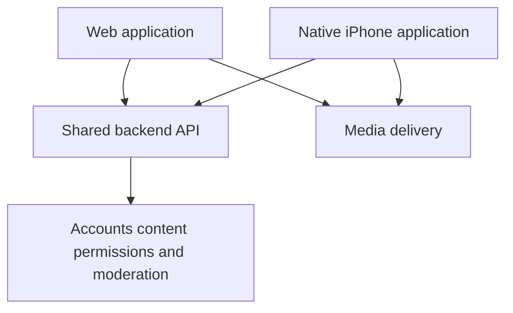

# Web and Native Video Viewing Roadmap

Created: 2026-10-18

Artifact: [Web and Native Video Viewing Roadmap](https://chatgpt.com/space/page_7bdd6dd99d048191a8df5747c8374bf8)

Maintain the web app and expand the accepted iPhone video POC into a complete native viewing application. Both clients use one backend for accounts, content, permissions, engagement, and moderation. Signed-in native Global/Spaces viewing is accepted in Plan 168; Plan 169 completes creator profiles and authorized personal-space return for the recorded iPhone development milestone, with coverage limits retained.

## Product and architecture

The web app continues to support viewing and the existing creation, publishing, administration, and moderation tools. The native app grows around the tested swipe player, bounded preloading, lifecycle recovery, and saved sound settings. Native controls and navigation can differ from the browser while preserving the same content and access rules.

Share API contracts, validation, and business rules where useful. Keep browser rendering and native playback independent. Continue the existing separate mobile package; a monorepo tooling migration is not required to add features.

## Current foundation

| Capability | Current position |
| --- | --- |
| Native video viewing | Anonymous/signed-in Global and accessible Spaces, preloading, pause, sound, lifecycle and recovery accepted on the test iPhone |
| Space viewing | Minimized viewer API and native selector/feeds implemented; device denial/restoration and expired-session recovery accepted |
| Viewer details | Native creator/profile and authorized personal-feed return accepted on the recorded development iPhone, supported by host/API/browser checks. Stories/captions accepted in bundled build2 under Plans170/171 with coverage/readability limits |
| Participation | Existing services support comments, likes, contextual follows, and reporting |
| App authentication | Native sessions, secure restore, account switching and online/offline logout implemented and accepted |
| Independent distribution | Signed iPhone development build installed/accepted; bundled internal Release preview accepted in Plan171 with Metro/tunnel off; TestFlight/public release remain later |

Existing endpoints are starting points. Their response fields, permission behavior, and errors need contract tests before native adoption.

## Delivery sequence

### 1 Establish viewer contracts

Inventory web viewer actions and assign them to native milestones. Add explicit viewer response shapes and consistent pagination and errors. Keep email, storage keys, processing jobs, and moderation internals out of public viewer responses. New contracts must preserve existing web behavior during adoption.

### 2 Deliver signed in viewing across Global and spaces

Allow existing users to sign in, restore a saved session, sign out, and return to anonymous Global browsing. Add native navigation and a space selector for the user's personal space and existing group and channel relationships. Reuse the current player for every feed, enforce permissions on the server, and clear account-specific state when identity changes.

This first milestone covers browsing existing accessible spaces. New-account onboarding, broad space discovery, membership changes, profiles, stories, captions, and social participation follow in later milestones.

### 3 Complete viewing and discovery

Add group and channel discovery, creator profiles, authorized personal-space entry, stories, app captions, and shared-video links with browser fallback. Define playback behavior for each screen and overlay. Keep publication identity separate from production identity when moving between spaces.

[Plan 170](../implementation/plan_170.md) is Complete (A–F): publication story previews/full-text reading and timed production captions, with a saved native CC preference. Host/API/browser/rendered checks and focused iPhone observations establish publication-correct text and selected-player caption behavior. Stories are written narratives specific to a publication. Text reads match the exact publication's eligibility; captions preserve the three-player limit.

[Plan 171](../implementation/plan_171.md) is also Complete (A–F) for bundled internal distribution. Video Viewer0.1.0/build2 embeds Release JavaScript, reuses the app identity and retains explicitly enabled internal reports. It works with Metro/tunnel stopped. The final stable-Wi-Fi/CC-on sample passes:40/40 normal prepared, first-frame p95 126.87ms, peak3, zero recorded errors/incomplete/unexpected playback; user reports no spinners/frozen controls/overlapping audio. Medium text is readable; larger-size button clipping is explicitly deferred. Physical/host coverage limits remain in the plans and acceptance matrix. Discovery and shared links remain later work.

### 4 Add participation and remaining feed behavior

Add comments, likes, contextual follows, reporting, and membership or invitation workflows. Preserve the product rule that Global is for discovery and engagement belongs inside spaces. Reconcile differences between the current web behavior and that rule before copying them.

Integrate in-feed messages and production viewing analytics separately from the POC's local diagnostic reports. Account for platform-specific requirements before introducing subscription or donation checkout.

### Delivered UI refinement after bundled acceptance

The user’s design notes from 2026-10-22 are implemented in [Plan 172](../implementation/plan_172.md), following Plan171. Signed build6 is installed, and controls/header/navigation/pause/Refresh/lifecycle/settings/offline-signout checks pass over recorded ranges. The final confirmed stable-Wi-Fi/CC-on sample passes:42/42 normal prepared, first-frame p95121.03ms, peak3, zero errors/incomplete/unexpected playback. User confirms the brief separate CC spinner is gone, captions follow speech and no controls freeze or audio overlaps. Build5’s earlier155.13ms p95 miss remains recorded; no causal performance claim. Plan172 A–F and documentation handoff are Complete with recorded limits. The implemented changes are:

- Replaced changing CC On/Off text with a constant **CC** in a compact rounded-square pill. White at 50% opacity means off; white at 100% means on.
- Replaced Mute/Unmute text with an audio symbol in a matching rounded-square pill. The user confirmed 50% off / 100% on, matching CC; speaker artwork also distinguishes states.
- Made the current space label (for example Global) open the existing full-screen space selector when tapped.
- Added a hamburger menu at the upper right with Login/Logout and Settings, reducing the persistent toolbar labels.
- Validated controls and layout over recorded phone/host ranges while preserving original-feed return, intentional pause, sound and selected-only playback. The new header passes at the largest tested size; full large-text and physical VoiceOver qualification remain separate.

VoiceOver remains deferred by the user. Plan172 moves internal diagnostics to Menu and retains Refresh there, preserving one Feed owner, current authority and original-feed checkpoints. The header passes at the largest tested size with accepted ellipsis; full maximum-size qualification across other screens remains unverified. Fresh preference persistence passes; pre/post upgrade comparison is unverified. Brief Checking Access on protected returns remains current policy and a separate polish candidate. Host/navigation tests, signed artifact and focused phone acceptance are recorded. This plan does not establish accessibility or public-release qualification.

### Delivered increment: Global-to-space launch and return

[Plan 173](../implementation/plan_173.md) is Complete (A–F) for signed build10 with recorded limits. It adds the right-side Creator action and a Global-only Launch chooser, then opens the exact eligible publication in an accessible group/channel and restores the original Global video/time/pause on Back. Existing Creator/personal detours remain composable through bounded return state.

The first increment requires sign-in to list/enter destinations, matching existing space-feed policy. It includes currently viewable public non-member spaces, excludes inaccessible/private and personal destinations, and includes the source's own group/channel when eligible. Native viewer APIs must independently validate Global source eligibility and exact destination authority; the older browser Jump lookup is not reused with native credentials. Missing targets cannot silently autoplay another publication. Sign-in/account changes discard old intents and return to Global; broader join/subscription workflows are deferred.

Global remains discovery-only, without Like/Comment controls or counts. Native likes/comments inside spaces are the following separate increment, including shared server context/permission enforcement. Plan173 backend/native, fixture/API/browser and signed build10 checks pass. Recorded phone acceptance includes exact paused/playing/nested return, destination Refresh, caption/story correctness, lifecycle/manual pause, quiet bounded routine renewal, automatic permission denial and recovery, offline recovery and protected sign-out. Entry/return and failed/expired verification still block. Test grants/visibility are restored and no active native fixture sessions remain. The confirmed stable-Wi-Fi/CC/usual-size forward sample passes unchanged numeric thresholds (54 transitions,52 prepared,p95132.86ms,98.11% normal preparation,peak3,0 errors/incomplete/unexpected). Full timeline review retains an isolated recovered cold186 start (firstFrame7.96s/playing8.27s/progress8.65s, repeat prepared firstFrame123ms) with unconfirmed cause; no extra phone run required.34 prepared rows with>=2s media progress also pass p95133.48ms. Variable dwell/bounded event history, physical maximum geometry, upgrade comparison, VoiceOver/native memory and public-release limits remain explicit. Commit/push authorized by the user on 2026-10-23; delivery verification is in progress.

### 5 Validate and distribute

Introduce an independent Expo development build during the expansion so app-specific configuration is tested early. Use TestFlight before public distribution and run release-build performance, accessibility, memory, network recovery, and account-isolation checks. Expo recommends development builds for apps intended for app-store release. [Expo development builds](https://docs.expo.dev/develop/development-builds/introduction/)

The direct-install internal preview in Plan171 is accepted and replaces the development client on the registered iPhone. Its embedded JavaScript removes the Metro code-loading dependency while retaining the HTTPS API and CloudFront media paths. This is an instrumented Release milestone; TestFlight, uninstrumented store-build qualification and public release remain separate. Moving code loading off the tunnel does not establish the cause of earlier media buffering.

## Boundaries that guide every milestone

- Keep the web app operational throughout the rollout, using additive API changes and focused browser regression tests.
- Apply the same server-side permissions to both clients. Following or seeing a Global item must never grant personal-space access.
- Preserve the native player limit of three and stop playback when a screen loses eligibility.
- Treat feed authorization and media authorization separately. The POC uses unsigned HLS playback URLs; protected media requires an explicit delivery policy, including playlists, segments, and posters.
- Revalidate saved credentials with the server. Store native credentials using secure device storage; reserve ordinary preference storage for non-secret settings.
- Require phase-specific evidence before marking a milestone complete.

## First milestone acceptance

An existing user can browse Global anonymously, sign in, select an existing accessible space, swipe through its videos, restart the app and restore the session, and sign out safely. Denied or expired access has a clear recovery path. Old requests and hidden screens cannot replay stale content after account or space changes. The browser remains functional.

## Execution documents

The first delivered viewer milestone is [Plan168](../implementation/plan_168.md). [Plan169](../implementation/plan_169.md) completes creator profiles, authorized personal-space entry and return for the recorded development milestone, pushed as `49e8dd6`. [Plan170](../implementation/plan_170.md) and [Plan171](../implementation/plan_171.md) are Complete (A–F) for native stories/captions and the signed bundled internal iPhone milestone, with recorded limits; their implementation is committed and pushed as `1dfd494`, with remote implementation SHA verified. [Plan172](../implementation/plan_172.md) delivers the control/header/menu refinement; build6 functional and numerical phone acceptance passes with recorded limits, and A–F and documentation handoff are Complete with recorded limits. Implementation is committed/pushed as `f0ed1b3`; remote implementation SHA verified, with delivery records following separately. [Plan173](../implementation/plan_173.md) implements Creator/Global-to-space launch and return; A–F Complete for signed build10 with recorded limits; commit/push authorized on 2026-10-23; delivery verification is in progress. Implementation status/evidence belongs in the repository plans; this roadmap retains high-level sequencing.

## Repository references

- [Detailed first-milestone plan](../implementation/plan_168.md)
- [Creator profiles and personal-feed return plan](../implementation/plan_169.md)
- [Publication stories and timed captions plan](../implementation/plan_170.md)
- [Bundled internal iPhone plan](../implementation/plan_171.md)
- [Native controls, space navigation and account menu plan](../implementation/plan_172.md)
- [Native Creator and Global-to-space launch plan](../implementation/plan_173.md)
- [Accepted native POC](../implementation/plan_167.md)
- [Context integrity contract](../features/feature_02_personal-space-global-feed-context-integrity.md)

This roadmap describes intended scope and sequencing. Phase execution status remains in the implementation plans. Later milestones need their own plans before execution.

## Current milestone status

Plan 168 is Complete (A–H) for signed-in native Global/Spaces viewing alongside the web app. Independent Video Viewer 0.1.0/build 1 acceptance includes authentication/storage, context/account isolation, playback/lifecycle/sound, offline recovery/logout, normal Wi-Fi timing and mixed browsing. The mixed report records 104 selections/frames, zero errors/incomplete, prepared first-frame p95 about 136 ms and peak three players. Device denial stopped audible playback while identity remained valid; restored access recovered through Refresh without login; session expiry returned to anonymous Global. Fixtures were restored and the test session cleaned up.

VoiceOver was explicitly deferred; high-text-size pill clipping is accepted. Cancellation passed controlled actual-component cases while the too-fast physical gesture remains unexercised. Handled guard events, compact-history limits and an earlier non-reproduced whole-app freeze with unconfirmed cause remain recorded in the plan. This is development-viewer acceptance using public fixture media, not private-CDN or public-release qualification. Plan 169 is also Complete for creator profiles, authorized personal-space entry and original-feed restoration. Device return/pause/mute, access loss/recovery, session expiry and offline return passed; the final Wi-Fi sample records 40/40 prepared normal transitions, first-frame p95 120.38 ms, zero errors/incomplete/unexpected playback and peak three players. One brief spinner and an earlier whole-app freeze with unconfirmed native cause remain documented; no recurrence was reported in the post-correction short/final checks. Qualitative seek/duration, host-versus-physical edge-case coverage and accessibility limits are retained. Plan 169 is committed/pushed as `49e8dd6`. Plans170/171 are Complete for stories/captions and bundled build2 acceptance, with explicit coverage and larger-text limits. The final stable-Wi-Fi/CC-on report meets the gate, and the user confirms no visible stalls/freeze/overlap. Both fixture accounts have zero active sessions and original permission is restored. UI refinement is recorded above; further discovery/participation features have not started.
