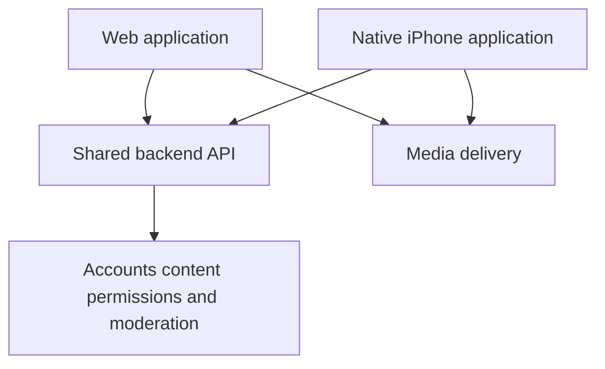

# Web and Native Video Viewing Roadmap

Created: 2026-10-18

Artifact: [Web and Native Video Viewing Roadmap](https://chatgpt.com/space/page_7bdd6dd99d048191a8df5747c8374bf8)

Maintain the web app and expand the accepted iPhone video POC into a complete native viewing application. Both clients use one backend for accounts, content, permissions, engagement, and moderation. Signed-in native Global/Spaces viewing is accepted in Plan 168; Plan 169 completes creator profiles and authorized personal-space return for the recorded iPhone development milestone, with coverage limits retained.

## Product and architecture

The web app continues to support viewing and the existing creation, publishing, administration, and moderation tools. The native app grows around the tested swipe player, bounded preloading, lifecycle recovery, and saved sound settings. Native controls and navigation can differ from the browser while preserving the same content and access rules.

Share API contracts, validation, and business rules where useful. Keep browser rendering and native playback independent. Continue the existing separate mobile package; a monorepo tooling migration is not required to add features.

## Current foundation

| Capability | Current position |
| --- | --- |
| Native video viewing | Anonymous/signed-in Global and accessible Spaces, preloading, pause, sound, lifecycle and recovery accepted on the test iPhone |
| Space viewing | Minimized viewer API and native selector/feeds implemented; device denial/restoration and expired-session recovery accepted |
| Viewer details | Native creator/profile and authorized personal-feed return accepted on the recorded development iPhone, supported by host/API/browser checks. Stories/captions accepted in bundled build2 under Plans170/171 with coverage/readability limits |
| Participation | Existing services support comments, likes, contextual follows, and reporting |
| App authentication | Native sessions, secure restore, account switching and online/offline logout implemented and accepted |
| Independent distribution | Signed iPhone development build installed/accepted; bundled internal Release preview accepted in Plan171 with Metro/tunnel off; TestFlight/public release remain later |

Existing endpoints are starting points. Their response fields, permission behavior, and errors need contract tests before native adoption.

## Delivery sequence

### 1 Establish viewer contracts

Inventory web viewer actions and assign them to native milestones. Add explicit viewer response shapes and consistent pagination and errors. Keep email, storage keys, processing jobs, and moderation internals out of public viewer responses. New contracts must preserve existing web behavior during adoption.

### 2 Deliver signed in viewing across Global and spaces

Allow existing users to sign in, restore a saved session, sign out, and return to anonymous Global browsing. Add native navigation and a space selector for the user's personal space and existing group and channel relationships. Reuse the current player for every feed, enforce permissions on the server, and clear account-specific state when identity changes.

This first milestone covers browsing existing accessible spaces. New-account onboarding, broad space discovery, membership changes, profiles, stories, captions, and social participation follow in later milestones.

### 3 Complete viewing and discovery

Add group and channel discovery, creator profiles, authorized personal-space entry, stories, app captions, and shared-video links with browser fallback. Define playback behavior for each screen and overlay. Keep publication identity separate from production identity when moving between spaces.

[Plan 170](../implementation/plan_170.md) is Complete (A–F): publication story previews/full-text reading and timed production captions, with a saved native CC preference. Host/API/browser/rendered checks and focused iPhone observations establish publication-correct text and selected-player caption behavior. Stories are written narratives specific to a publication. Text reads match the exact publication's eligibility; captions preserve the three-player limit.

[Plan 171](../implementation/plan_171.md) is also Complete (A–F) for bundled internal distribution. Video Viewer0.1.0/build2 embeds Release JavaScript, reuses the app identity and retains explicitly enabled internal reports. It works with Metro/tunnel stopped. The final stable-Wi-Fi/CC-on sample passes:40/40 normal prepared, first-frame p95 126.87ms, peak3, zero recorded errors/incomplete/unexpected playback; user reports no spinners/frozen controls/overlapping audio. Medium text is readable; larger-size button clipping is explicitly deferred. Physical/host coverage limits remain in the plans and acceptance matrix. Discovery and shared links remain later work.

### 4 Add participation and remaining feed behavior

Add comments, likes, contextual follows, reporting, and membership or invitation workflows. Preserve the product rule that Global is for discovery and engagement belongs inside spaces. Reconcile differences between the current web behavior and that rule before copying them.

Integrate in-feed messages and production viewing analytics separately from the POC's local diagnostic reports. Account for platform-specific requirements before introducing subscription or donation checkout.

### Delivered UI refinement after bundled acceptance

The user’s design notes from 2026-10-22 are implemented in [Plan 172](../implementation/plan_172.md), following Plan171. Signed build6 is installed, and controls/header/navigation/pause/Refresh/lifecycle/settings/offline-signout checks pass over recorded ranges. The final confirmed stable-Wi-Fi/CC-on sample passes:42/42 normal prepared, first-frame p95121.03ms, peak3, zero errors/incomplete/unexpected playback. User confirms the brief separate CC spinner is gone, captions follow speech and no controls freeze or audio overlaps. Build5’s earlier155.13ms p95 miss remains recorded; no causal performance claim. Plan172 A–F and documentation handoff are Complete with recorded limits. The implemented changes are:

- Replaced changing CC On/Off text with a constant **CC** in a compact rounded-square pill. White at 50% opacity means off; white at 100% means on.
- Replaced Mute/Unmute text with an audio symbol in a matching rounded-square pill. The user confirmed 50% off / 100% on, matching CC; speaker artwork also distinguishes states.
- Made the current space label (for example Global) open the existing full-screen space selector when tapped.
- Added a hamburger menu at the upper right with Login/Logout and Settings, reducing the persistent toolbar labels.
- Validated controls and layout over recorded phone/host ranges while preserving original-feed return, intentional pause, sound and selected-only playback. The new header passes at the largest tested size; full large-text and physical VoiceOver qualification remain separate.

VoiceOver remains deferred by the user. Plan172 moves internal diagnostics to Menu and retains Refresh there, preserving one Feed owner, current authority and original-feed checkpoints. The header passes at the largest tested size with accepted ellipsis; full maximum-size qualification across other screens remains unverified. Fresh preference persistence passes; pre/post upgrade comparison is unverified. Brief Checking Access on protected returns remains current policy and a separate polish candidate. Host/navigation tests, signed artifact and focused phone acceptance are recorded. This plan does not establish accessibility or public-release qualification.

### Delivered increment: Global-to-space launch and return

[Plan 173](../implementation/plan_173.md) is Complete (A–F) for signed build10 with recorded limits. It adds the right-side Creator action and a Global-only Launch chooser, then opens the exact eligible publication in an accessible group/channel and restores the original Global video/time/pause on Back. Existing Creator/personal detours remain composable through bounded return state.

The first increment requires sign-in to list/enter destinations, matching existing space-feed policy. It includes currently viewable public non-member spaces, excludes inaccessible/private and personal destinations, and includes the source's own group/channel when eligible. Native viewer APIs must independently validate Global source eligibility and exact destination authority; the older browser Jump lookup is not reused with native credentials. Missing targets cannot silently autoplay another publication. Sign-in/account changes discard old intents and return to Global; broader join/subscription workflows are deferred.

Global remains discovery-only, without Like/Comment controls or counts. Native likes/comments inside spaces are the following separate increment, including shared server context/permission enforcement. Plan173 backend/native, fixture/API/browser and signed build10 checks pass. Recorded phone acceptance includes exact paused/playing/nested return, destination Refresh, caption/story correctness, lifecycle/manual pause, quiet bounded routine renewal, automatic permission denial and recovery, offline recovery and protected sign-out. Entry/return and failed/expired verification still block. Test grants/visibility are restored and no active native fixture sessions remain. The confirmed stable-Wi-Fi/CC/usual-size forward sample passes unchanged numeric thresholds (54 transitions,52 prepared,p95132.86ms,98.11% normal preparation,peak3,0 errors/incomplete/unexpected). Full timeline review retains an isolated recovered cold186 start (firstFrame7.96s/playing8.27s/progress8.65s, repeat prepared firstFrame123ms) with unconfirmed cause; no extra phone run required.34 prepared rows with>=2s media progress also pass p95133.48ms. Variable dwell/bounded event history, physical maximum geometry, upgrade comparison, VoiceOver/native memory and public-release limits remain explicit. Implementation is committed/pushed as `c8583f0`; remote implementation SHA verified, with delivery records following separately.

### Delivered increment: native Likes and Comments

[Plan174](../implementation/plan_174.md) is Complete: A–F for signed build15 with recorded limits. Requested performance conditions, smooth run and local sign-out are confirmed; scoped cleanup passes. Remote revocation was not observed and exact remaining test session96 was separately revoked by host. Native Like/unlike and top-level Comments share exact-space/publication authority, posting capability and atomic counters with browser engagement. Global stays discovery-only; native replies/liker directory remain later work. Signed build15 is installed; focused phone checks pass for the agreed count/sort selector,80% scrim, footer, larger-text keyboard/body limits, paging, disabled-post reading, opaque denial/recovery and nested paused return. Report numerical gate passes:43/47 normal prepared,p95117.39ms,peak3,zero errors/incomplete/unexpected; final40/40 forwards prepared,p95113.64ms with playing/progress. Earlier functional missing/delayed progress and bounded event history are retained. Build10 cold186 cause remains unresolved. Plan174 implementation committed/pushed as `90005a0`; remote implementation SHA verified, with delivery documentation following separately.

### Accepted refinement: stable Follow spacing and stronger relationship rings

[Plan181](../implementation/plan_181.md) A–C Complete for the accepted build33 milestone with recorded limits:234 unit/92 rendered/typecheck and19 focused Follow cases pass;8 new cases fail before the fix. A permanent44-point slot beneath the44-point group/channel creator avatar keeps its group height stable while initial checks stay silent. Verified plus, deliberate-write feedback and read-only retry occupy that slot. Shared green/yellow borders are doubled from1 to2 points, including Global yellow recognition; gray1, avatar bounds, exact-space authority and playback remain. Global/personal gain no Follow action. [build33](https://expo.dev/accounts/mbcollins2/projects/aws-video-feed-poc/builds/aeef06b5-54d1-4dbf-85cb-fdb934eeb0f6) source/archive/export/downloaded signed artifact/API/native module/accepted-phone signing verified; OTA off. User confirms stable spacing/no initial dots/correct plus, visibly thicker rings including Global without avatar resizing, Follow/profile Unfollow and preserved swipes/position/pause/clear audio/silent loading. Other physical/numerical cases remain unverified. Accepted build32 comparison and predecessor limits remain. Commit/push explicitly requested.

### Accepted increment: uniform loading cover and full-picture reveal

[Plan180](../implementation/plan_180.md) documents the user-approved full black/loading cover recommendation; A–C Complete for the accepted build32 milestone with recorded limits;234 unit/84 rendered/typecheck and8 focused cover cases pass. The former stage cover left transparent padding above its black child, exposing incoming poster/video behind the floating header while the lower area was covered. The outer cover now has full-stage opacity while feedback stays inset below the measured header; Space/Menu and destination name remain visible on black. Reveal the whole restored picture together under the existing readiness/presentation contract, preserving saved publication/time/manual pause, fresh pools and seamless ordinary paging. Exact poster-versus-frame observation remains unconfirmed; both must be concealed. No frozen preview, fade, backend change or new readiness policy is planned. The full-stage black outer surface is implemented; [build32](https://expo.dev/accounts/mbcollins2/projects/aws-video-feed-poc/builds/c2fff865-8404-4e5c-a5b6-b1fd6d29723a) source/archive/export/downloaded signed artifact/API/native module/accepted-phone signing are verified, OTA off. The user confirms whole-picture black loading/unified saved-position reveal with visible Space/Menu, paused/playing continuity, clear return audio/silent loading and smooth within-feed swipes. Numerical/other physical cases remain scoped. Implementation committed locally as `243086e`; not pushed; accepted build31 and local unpushed `adeed1e`/`7f6f083` are preserved.

### Accepted increment: creator, publishing time and optional story panel

[Plan179](../implementation/plan_179.md) records the agreed native panel design; A–D Complete for the recorded build31 milestone with coverage limits;234 unit/81 rendered/58 backend/typecheck/build and live date checks pass. The collapsed bottom-left panel always shows creator name and publication date/time in the viewer's local time zone. Only a publication story adds the upper-right up/down chevron with Expand/Collapse story VoiceOver labels. Expansion grows upward with bounded scrolling, preserving creator-profile navigation, captions, video framing and the footer. Remove the separate creator name and upload-description fallback. The native viewer API now supplies an additive nullable publication-specific UTC timestamp; schema and web UI are unchanged. Implementation is explicitly authorized; [Build31](https://expo.dev/accounts/mbcollins2/projects/aws-video-feed-poc/builds/607f1a49-0428-4728-a256-2eaa71ea45f9) source/archive/export/downloaded signed artifact/API/accepted-phone signing are verified; OTA off. The user confirms the focused Global/other-feed creator/date/story/profile/caption checks. Short-phone/large-text/VoiceOver and additional playback/performance cases remain unverified. Implementation committed locally as `adeed1e`; not pushed. Plan178 is pushed as `71aab2a`; build30 and predecessor evidence limits are preserved.

### Delivered increment: uniform edge-to-edge feeds and Space switching

[Plan178](../implementation/plan_178.md) implements the next iPhone layout increment after explicit approval; A–E host/artifact qualification complete, F In Progress with qualitative user acceptance.232 unit/76 rendered/typecheck pass; [Install build30](https://expo.dev/accounts/mbcollins2/projects/aws-video-feed-poc/builds/2ff9a4f7-dad3-4f9b-aff3-05b2a837775c) source/archive/export/downloaded signed artifact/native sizing API and accepted-phone signing verified; OTA off. The user agrees to full-width, aspect-preserving video behind status indicators, with equal top/bottom crop on shorter screens and top alignment/black spare area when it fits. One floating safe-area header replaces normal-flow feed headers and Back to Global. Spaces becomes an80% black overlay; selecting a prior feed restores a bounded scalar checkpoint into fresh players, while Close/current selection retains the current player. A black footer reserves future Home/Following, Friends, Inbox, own Profile and group/channel Search navigation; these destinations require separate feature contracts and are not inactive buttons in this increment. The header-height explanation remains a source-based inference; actual AVPlayer clipping/status geometry still needs physical qualification. Native displayed-size reads are bounded and do not seek or change player ownership. Pushed predecessor `cb2c93f` and build29 are preserved, including prior open evidence/cleanup limits. No backend/web frontend change. Committed/pushed as `71aab2a`; specific physical cases and predecessor limits remain open.

### Delivered checkpoint: fresh players and named loading splashes

[Plan177](../implementation/plan_177.md) now implements user-approved fresh native pools and named opaque Loading splashes for startup and actual feed changes/returns. Build27 manual and build28 automatic full-height readiness are accepted, while build28 retained Global return produced static despite correct position. Cross-feed native retention was removed; scalar checkpoints and bounded authorized JSON remain, Launch → Close preserves its original player, and within-feed preloading keeps the full3-player window. A–E Complete for host/artifact qualification; F In Progress.227 unit/71 rendered/typecheck pass; [Install build29](https://expo.dev/accounts/mbcollins2/projects/aws-video-feed-poc/builds/d457b46e-af26-41f9-9439-e6faee85ad7d) source/archive/export/downloaded signed artifact/native module/accepted-phone provisioning verified; OTA disabled. User accepts build29 seamless within-feed scrolling and loading feedback between feeds and requests commit/push. Explicit audio/quantitative/edge-case evidence remains open; no SDK/mixing change or proven native static cause is claimed. Plan175/176 outstanding performance/sign-out/cleanup and deferred phone gates remain open; sessions/fixtures are preserved.

### Active increment: shared access and navigation continuity

[Plan176](../implementation/plan_176.md) implements shared in-memory confirmations with original60s expiry/quiet renewal, combined prepared Launch entry, bounded public Global return and recovery without logout. A–E Complete for build24; R1/R2/F In Progress. Build24 phone feedback reported considerable buffering improvement but Launch audio distortion; build25 fresh-player isolation source/archive/export/downloaded IPA/provisioning verified (`86577c07-7b15-4f32-8c4e-cd35d2efe274`). Latest user feedback reports normal playing sound and remaining unlabeled progress waits, without complete version/pause/time/audio qualification. R2 adds visible operation labels; native206 unit/61 rendered/typecheck pass and build26 `7c340ac8-b396-4b4c-9349-f1d8ff4af976` source/archive/export/downloaded signed artifact/provisioning are verified; phone identifies Loading video to restore position on group entry and Global return. Build26 full export confirms warm data/access readiness11–25ms and restoration medians716ms entering the group/584ms returning. Fresh media readiness plus restoration dominate. A bounded stable-view/one-fresh-destination follow-up is drafted in the plan; whole-history incomplete/slow events and remaining phone gates stay open. Existing backend/API/browser evidence and exact fixture/session preservation remain recorded in the plan. Server authorization stays on every protected request; private media delivery and joining/age/payment/approval remain separate. Plan175 E/F, deferred offline/nested phone observation and final performance/sign-out/scoped cleanup remain open. No new commit/push requested; baseline `407fe73` remains unpushed.

### Active increment: contextual creator Follow and Launch presentation

[Plan175](../implementation/plan_175.md) has A–D Complete for the historical build16 baseline; subsequent work through build23 is committed as `407fe73`. Build16 implements creator+space Follow/unfollow and scoped count on Creator profile, with shared browser/native exact-source authorization and independently checked personal access. Backend44/native179 unit+38 rendered,126 real Follow API/18 browser checks and engagement237 API/12 browser regressions passed for that source. The signed artifact was verified; the user confirmed installation, Global playback and saved CC/audio preferences after a host API outage/recovery. Initial phone observations confirm no Global profile Follow and a reachable group profile Follow/Unfollow action; counts, persistence and paused return were not explicitly confirmed.

The user then identified a missing indicator in the group/channel video feed and requested Launch retain the originating video underneath. The agreed revision is implemented and host-qualified: R1 selected-video `Follow here` / `Following here` beside/below the avatar, with profile/feed consistency and no Global/personal Follow; R2 Launch as a transparent modal with one80% opaque black scrim, existing upper-right Close and scrollable destinations over the retained paused originating Feed, one shared source creator avatar/name/public bio and each space name/type/brief community and moderation description; R3 revised-source integration. Avatar still opens profile; Close restores publication/time/prior playing or manual-pause intent subject to current eligibility. No extra Feed/player or hidden audio. R1–R3 Complete; E In Progress and F Pending. Revised gates pass:48 backend,181 native unit/43 rendered,50 introduction API/7 settings-browser and126 Follow API/18 browser;237 engagement API retained. Build17 source/archive/export/downloaded signed artifact verified; user accepted installation, overlay/Follow/manual pause, renewal/foreground and access-loss/recovery sequences. Requested uniform Like/Comments outlines passed typecheck/43 rendered tests and build18 export/archive checks; replacement build18 signing/downloaded-artifact verification passed; installation/focused visual and remaining phone/performance gates remain. Build16 observations do not qualify revised UI. Plan174 cold-start/remote-revocation evidence limits remain open.

The subsequent authorized R4 replaces the feed text control with a plus immediately below the avatar: gray means no Follow, yellow means following elsewhere only, green means following here and removes the plus. Avatar keeps profile entry and profile Unfollow. Caller-owned `followingElsewhere` is returned with the existing exact-source summary, without other-space details/access grants.49 backend/182 native unit/44 rendered/typecheck,143 mounted Follow API/18 browser and live HTTPS checks pass; build20 export/archive/downloaded signed artifact verified; user accepted contextual green/yellow observations as stated. Build18 outlines/usability were accepted; actual tested font setting/range was not supplied.

R5 adds read-only recognition to authenticated Global: yellow when the selected video's creator is followed in any group/channel, gray otherwise, with no Global green/plus or Follow card. Exact Global source/creator is rechecked, only a caller-owned boolean is returned, and optional recognition failures do not block public playback.51 backend/183 native unit/46 rendered/typecheck,171 mounted Follow/recognition API/18 browser and live HTTPS checks pass; build21 export/archive/downloaded artifact/source/provisioning verified; user accepted the requested focused Global phone sequence; remaining offline/nested return and final performance/sign-out/cleanup gates stay open. User accepted build20 contextual green/yellow observations as stated; broader final performance/sign-out/scoped cleanup remain open.

R6 addresses the user's longer Global → Launch → Space → Global waits: prepare one selected-source introduction list, share the initial authorized feed/access request, use20-item anchored windows and transfer one paused player only for exact media after fresh validation. Original pause/time, fresh Global source authorization, bounded lifecycle and3-player cap remain.194 native unit/52 rendered/typecheck and read-only live identity/session preservation checks pass; build23 export/archive/downloaded signed artifact verified, physical navigation timing pending. This is a native-only change. Offline/nested physical acceptance stays explicitly deferred; final performance/sign-out/scoped cleanup remain open.

The common creator header must be true for every choice. Implemented R2 enforces upload-creator and production equality on list and resolve, reuses public Creator visibility projection, and adds bounded authorized space-description metadata and an existing-settings authoring field. No inferred cultural claims, raw settings or protected moderation data. Missing descriptions/bios and broken avatars have honest fallbacks. Targeted backend/real-API/native/space-settings tests precede replacement signing; identity-aligned disposable fixtures cannot be achieved by modifying ordinary content.

### Sequenced follow-on: discovery, space introductions and entry requirements

Agreed product path: Global introduces creators through creator-selected, broadly public-safe distribution → Launch offers permitted creator-space introductions → Follow this creator's column here → explain and resolve actual unmet space requirements → revalidate eligibility → explicit Follow. Creators can publish primarily within spaces; public distribution does not make their entire column public. Following is independent of space membership, subscription and personal access.

Current Launch only lists already viewable spaces containing the same production; it hides inaccessible destinations. Broader discovery needs its own server-authorized introduction and discoverability contract, not a weaker feed check or an invented matching video. Undiscoverable private spaces remain hidden; permitted introductions expose only safe metadata, without protected publication/media/engagement data. Distinguish exact-video destinations from broader spaces where the creator actually publishes.

A Follow attempt with unmet requirements should show actual server-derived age-verification, paid-membership and/or administrator-approval requirements and functioning next actions. Requirements may combine; pending approval/verification/payment is not Following. Do not infer a reason from generic denial. Joining, requests and payment remain explicit; no auto-enrollment, charge, access grant or Follow. Preserve bounded account-specific intent and Global return; after fulfillment, independently recheck view/Follow policy and let the user explicitly complete Follow.

The dedicated follow-on plan must inspect real discoverability/settings, membership/subscription/approval records, age/payment providers and distribution constraints before selecting API/schema/integration changes. Its acceptance includes open/already-eligible/age-only/paid-only/approval-only/combined cases, pending/denied/expired/cancelled outcomes, public preview versus Follow requirements, hidden private groups, direct API bypass attempts, account/space isolation and real supported fulfillment paths. Plan175 records the full specification and dependencies; its immediate UI revision does not implement these workflows. Historical feature-document Global Follow is not part of this agreed discovery journey.

### 5 Validate and distribute

Introduce an independent Expo development build during the expansion so app-specific configuration is tested early. Use TestFlight before public distribution and run release-build performance, accessibility, memory, network recovery, and account-isolation checks. Expo recommends development builds for apps intended for app-store release. [Expo development builds](https://docs.expo.dev/develop/development-builds/introduction/)

The direct-install internal preview in Plan171 is accepted and replaces the development client on the registered iPhone. Its embedded JavaScript removes the Metro code-loading dependency while retaining the HTTPS API and CloudFront media paths. This is an instrumented Release milestone; TestFlight, uninstrumented store-build qualification and public release remain separate. Moving code loading off the tunnel does not establish the cause of earlier media buffering.

## Boundaries that guide every milestone

- Keep the web app operational throughout the rollout, using additive API changes and focused browser regression tests.
- Apply the same server-side permissions to both clients. Following or seeing a Global item must never grant personal-space access.
- Preserve the native player limit of three and stop playback when a screen loses eligibility.
- Treat feed authorization and media authorization separately. The POC uses unsigned HLS playback URLs; protected media requires an explicit delivery policy, including playlists, segments, and posters.
- Revalidate saved credentials with the server. Store native credentials using secure device storage; reserve ordinary preference storage for non-secret settings.
- Require phase-specific evidence before marking a milestone complete.

## First milestone acceptance

An existing user can browse Global anonymously, sign in, select an existing accessible space, swipe through its videos, restart the app and restore the session, and sign out safely. Denied or expired access has a clear recovery path. Old requests and hidden screens cannot replay stale content after account or space changes. The browser remains functional.

## Execution documents

The first delivered viewer milestone is [Plan168](../implementation/plan_168.md). [Plan169](../implementation/plan_169.md) completes creator profiles, authorized personal-space entry and return for the recorded development milestone, pushed as `49e8dd6`. [Plan170](../implementation/plan_170.md) and [Plan171](../implementation/plan_171.md) are Complete (A–F) for native stories/captions and the signed bundled internal iPhone milestone, with recorded limits; their implementation is committed and pushed as `1dfd494`, with remote implementation SHA verified. [Plan172](../implementation/plan_172.md) delivers the control/header/menu refinement; build6 functional and numerical phone acceptance passes with recorded limits, and A–F and documentation handoff are Complete with recorded limits. Implementation is committed/pushed as `f0ed1b3`; remote implementation SHA verified, with delivery records following separately. [Plan173](../implementation/plan_173.md) implements Creator/Global-to-space launch and return; A–F Complete for signed build10 with recorded limits; implementation committed/pushed as `c8583f0`; remote implementation SHA verified, with delivery records following separately. Implementation status/evidence belongs in the repository plans; this roadmap retains high-level sequencing.

## Repository references

- [Detailed first-milestone plan](../implementation/plan_168.md)
- [Creator profiles and personal-feed return plan](../implementation/plan_169.md)
- [Publication stories and timed captions plan](../implementation/plan_170.md)
- [Bundled internal iPhone plan](../implementation/plan_171.md)
- [Native controls, space navigation and account menu plan](../implementation/plan_172.md)
- [Native Creator and Global-to-space launch plan](../implementation/plan_173.md)
- [Native Likes and Comments plan](../implementation/plan_174.md)
- [Contextual creator Follow and Launch revision](../implementation/plan_175.md)
- [Accepted native POC](../implementation/plan_167.md)
- [Context integrity contract](../features/feature_02_personal-space-global-feed-context-integrity.md)

This roadmap describes intended scope and sequencing. Phase execution status remains in the implementation plans. Later milestones need their own plans before execution.

## Current milestone status

Plan 168 is Complete (A–H) for signed-in native Global/Spaces viewing alongside the web app. Independent Video Viewer 0.1.0/build 1 acceptance includes authentication/storage, context/account isolation, playback/lifecycle/sound, offline recovery/logout, normal Wi-Fi timing and mixed browsing. The mixed report records 104 selections/frames, zero errors/incomplete, prepared first-frame p95 about 136 ms and peak three players. Device denial stopped audible playback while identity remained valid; restored access recovered through Refresh without login; session expiry returned to anonymous Global. Fixtures were restored and the test session cleaned up.

VoiceOver was explicitly deferred; high-text-size pill clipping is accepted. Cancellation passed controlled actual-component cases while the too-fast physical gesture remains unexercised. Handled guard events, compact-history limits and an earlier non-reproduced whole-app freeze with unconfirmed cause remain recorded in the plan. This is development-viewer acceptance using public fixture media, not private-CDN or public-release qualification. Plan 169 is also Complete for creator profiles, authorized personal-space entry and original-feed restoration. Device return/pause/mute, access loss/recovery, session expiry and offline return passed; the final Wi-Fi sample records 40/40 prepared normal transitions, first-frame p95 120.38 ms, zero errors/incomplete/unexpected playback and peak three players. One brief spinner and an earlier whole-app freeze with unconfirmed native cause remain documented; no recurrence was reported in the post-correction short/final checks. Qualitative seek/duration, host-versus-physical edge-case coverage and accessibility limits are retained. Plan 169 is committed/pushed as `49e8dd6`. Plans170/171 are Complete for stories/captions and bundled build2 acceptance, with explicit coverage and larger-text limits. The final stable-Wi-Fi/CC-on report meets the gate, and the user confirms no visible stalls/freeze/overlap. Both fixture accounts have zero active sessions and original permission is restored. Later delivered UI refinement, Global Launch and Likes/Comments are recorded above. Plan175 has a tested build16 Follow baseline and partial phone observations; agreed feed Follow/Launch overlay revisions pass R1–R3, with E In Progress after build17 functional observations and requested build18 Like/Comments outline refinement, and F Pending. Discoverable space introductions and real membership/age/payment/approval workflows are the specified follow-on; broader participation remains later work.
